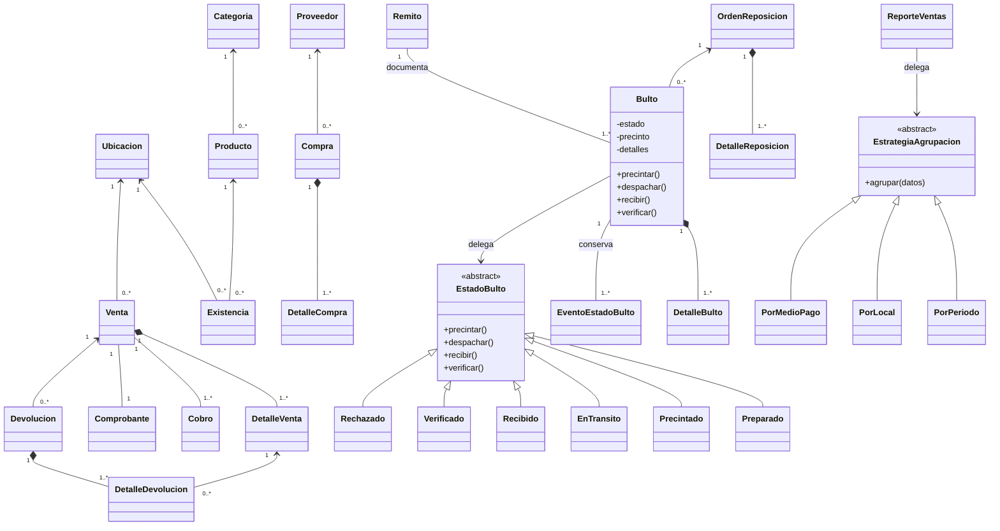
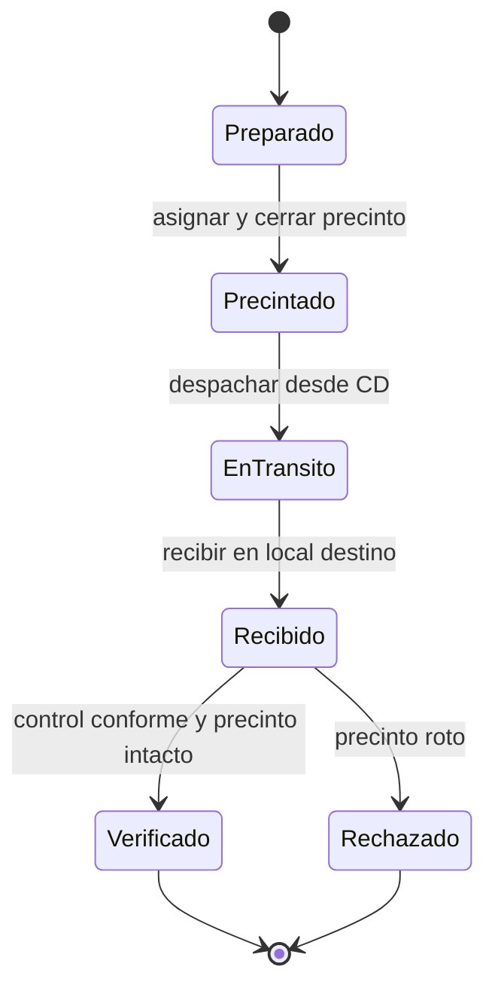
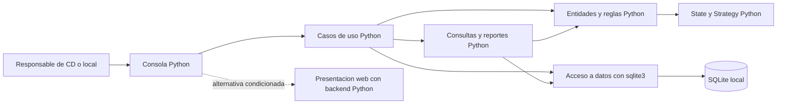
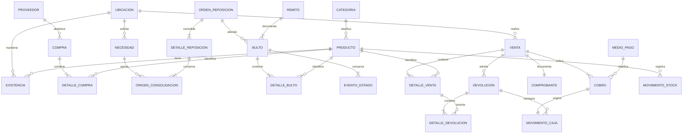

# Planificación del TP Integrador POO 2026 - Tema 3

**Sistema de Ventas e Inventario: Centro de Distribución a Locales**

- Fecha: 9 de octubre de 2026.
- Estado: **plan futuro propuesto para revisión; aplicación no implementada**.
- Audiencia: integrantes del grupo, docente y agentes que colaboren en el desarrollo.
- Propósito: convertir el enunciado en requisitos trazables, un modelo POO fundamentado y etapas verificables, preservando el nivel académico de DAO.
- Único artefacto autorizado en esta fase: `PLANIFICACION_TP_POO.md`.

## 0. Evidencia, autoridad y modo de lectura

### 0.1 Fuentes inspeccionadas

| Código | Fuente | Alcance y evidencia |
| --- | --- | --- |
| E1 | [tema3.pdf](tema3.pdf), página 1, Contexto | Comercio con varios locales y un CD; integración de compras, ventas, inventario y logística; resultado económico por período. |
| E2 | `tema3.pdf`, página 1, Procesos de negocio obligatorios, puntos 1-7 | Administración, reposición, empaquetado, despacho, recepción, venta, cobro, comprobantes y devoluciones. |
| E3 | `tema3.pdf`, página 1, Procesos de negocio opcionales | Cinco ampliaciones que no forman parte del alcance obligatorio. |
| E4 | `tema3.pdf`, página 2, Validaciones de negocio | Doble verificación, rechazo logístico, trazabilidad inmutable, límite de venta, duplicados y devoluciones válidas. |
| E5 | `tema3.pdf`, página 2, Reportes sugeridos | Cinco familias de reportes sugeridas, sin imponer todos sus títulos. |
| E6 | `tema3.pdf`, página 2, Consideraciones particulares | Identificar entidades y reglas adicionales; evaluación crítica del ciclo del bulto; al menos dos patrones y cuatro reportes no triviales. |
| A | [AGENTS.md](AGENTS.md), leído completo | Autoridad, progresión académica, convenciones, POO, patrones, SQLite, pruebas y restricciones de trabajo. Las citas `A §n` remiten a sus secciones. |
| U | Pedido del usuario, adjunto `Texto pegado.txt`, secciones 1-8 | Backend exclusivamente Python; contenido de esta planificación; prohibición de implementar, instalar, inicializar, cambiar originales, hacer commits, push o despliegues. |

**Confirmado:** el directorio de trabajo contenía únicamente `tema3.pdf`, `AGENTS.md` y el directorio interno `.git`. `rg --files --hidden -g '!**/.git/**'` no encontró código, manifiestos, pruebas, instrucciones anidadas ni documentación adicional. `git ls-files` no enumeró archivos versionados; el estado inicial mostraba ambos originales sin seguimiento. No existe arquitectura previa que deba conservarse.

Se extrajeron las dos páginas del PDF y se revisaron visualmente ambas, renderizadas en memoria. No se modificó ni reexportó el enunciado.

**Límite de evidencia:** los seis materiales que `AGENTS.md` enumera en §15 no están en este repositorio. Sus contenidos no se presentan como leídos directamente: se utiliza la síntesis normativa de `AGENTS.md`. No se encontraron indicaciones docentes adicionales, rúbrica, fecha de entrega, formato de presentación ni restricciones de interfaz específicas.

### 0.2 Prioridad y clasificación

Para esta tarea se aplica: restricciones explícitas de U > obligaciones de E1-E6 > reglas académicas de A > decisiones técnicas justificadas. No se encontró una contradicción explícita entre U y el enunciado. La falta de reglas para algunos flujos es una incertidumbre, no autorización para inventarlas.

Las etiquetas tienen un significado estable en todo el documento:

- **Confirmado (C):** observado directamente en las fuentes o herramientas.
- **Inferido (I):** interpretación razonable de hechos confirmados; requiere aceptación cuando concreta una regla no expresada.
- **Supuestos (S):** información no verificada; se indica qué decisión depende de ella.
- **Propuesta (P):** elección de diseño o alcance del grupo, todavía no aprobada. No equivale a requisito del docente.

La prioridad de las matrices usa **O** para obligación confirmada, **D** para comportamiento derivado que debe acordarse antes de implementarlo y **P** para propuesta. Las funcionalidades opcionales usan **Opcional**. Un criterio derivado no convierte su política en una obligación de la cátedra.

### 0.3 Flujo de análisis aplicado

La tarea es documental y compleja por sus reglas de stock, ciclo logístico y transacciones. Se aplicaron las skills solicitadas con responsabilidades separadas: `engineering-orchestrator` para inspección y coordinación; `requirements-analysis` para alcance y aceptación; `architecture-design` para alternativas y ADR; `solution-planning` para incrementos; `technical-documentation` para trazabilidad y revisión. Se agregó la skill de PDF para la lectura completa y el contraste visual del enunciado.

El resultado de requisitos alimenta el diseño; el diseño propuesto alimenta las fases. No se ejecuta ninguna fase de implementación mediante este documento. Las referencias auxiliares `skill-composition.md` y `skill-handoff-contract.md` enlazadas por algunas skills no se localizaron; se utilizaron las instrucciones y plantillas disponibles, sin inventar su contenido.

## A. Descripción general del proyecto

### A.1 Objetivo y problema

**Confirmado:** el sistema debe integrar la actividad comercial de varios locales con el abastecimiento desde un CD. La dificultad central es mantener una correspondencia confiable entre mercadería física, ubicación, estado logístico, stock vendible y operaciones económicas.

Recibir físicamente un bulto no equivale a tener stock disponible. El sistema debe impedir que unidades sin verificación se vendan, conservar la historia del traslado y reflejar ventas y devoluciones tanto en inventario como en caja. Además, debe permitir consultar el resultado económico de las operaciones por período.

### A.2 Actores y contexto

| Actor del dominio | Objetivo | Nivel de evidencia |
| --- | --- | --- |
| Responsable de administración | Mantener locales, CD, catálogo, precios, mínimos y proveedores. | I: función necesaria para los procesos 1 y 2, sin rol de seguridad definido. |
| Responsable de compras/CD | Registrar abastecimiento, atender reposiciones, preparar y despachar bultos. | I, derivado de E1 y E2. |
| Responsable receptor de local | Recibir, revisar precinto y verificar o rechazar. | I, derivado de E2.6 y E4. |
| Vendedor/cajero del local | Registrar venta, cobro, comprobante y devolución. | I, derivado de E2.7. |
| Responsable de gestión | Consultar reportes y resultado económico. | I, derivado de E1 y E6. |
| Proveedor | Origen comercial de la compra. | C como entidad del negocio; no se exige acceso interactivo al sistema. |
| Comprador del público | Participa en ventas y devoluciones. | C en E1; no se exige registrar clientes ni darles acceso. |

Estos actores describen responsabilidades humanas. No implican cuentas, autenticación, perfiles ni permisos informáticos. Una persona puede cumplir varias funciones. Tampoco se exige una integración externa con bancos, transportistas o sistemas fiscales.

### A.3 Alcance base y resultado esperado

El alcance obligatorio comprende los siete procesos de E2, las cinco validaciones de E4, un modelo POO que represente correctamente el bulto, dos patrones justificados y cuatro reportes no triviales. También debe atenderse la integración de compras y el resultado económico de E1; su detalle operativo necesita acuerdo porque no está desarrollado en los procesos numerados.

**Propuesta de alcance base:** operación académica local, con todos los locales modelados en una base compartida; ingreso manual de compras al CD; reposición manual consolidada; circuito logístico completo; ventas cobradas, comprobantes internos y devoluciones; cuatro reportes de gestión. Persistencia entre ejecuciones y datos de prueba separados.

El resultado final esperado es una aplicación demostrable que permita seguir una mercadería desde su ingreso controlado al CD hasta su venta o rechazo, demostrar la imposibilidad de venderla antes de la doble verificación y explicar los impactos económicos sin reconstruir operaciones históricas con precios actuales.

Fuera del alcance base: sugerencias automáticas de compra, promociones, listas de precios alternativas, lotes/series/vencimientos, clientes frecuentes/cuentas corrientes, inventario físico y conciliación operativa. También quedan fuera, salvo instrucción nueva, pagos reales, facturación fiscal, servicios externos, despliegue público, múltiples monedas y sincronización entre instalaciones independientes.

## B. Análisis exhaustivo de requisitos

### B.1 Requisitos funcionales y aceptación

Los nombres de pruebas `T-nn`, casos `CU-nn` y fases `F-nn` son referencias de planificación; no existen todavía suites ni módulos implementados.

| ID | Requisito y evidencia | Prioridad / origen | Criterio de aceptación | Dependencias / validación |
| --- | --- | --- | --- | --- |
| RF-01 | Administrar sucursales/locales y CD (C). | O / E2.1 | Se pueden registrar, consultar y actualizar locales y un CD, distinguir su función y asociar operaciones a la ubicación correcta. El alcance de bajas se acuerda en DN-08. | CU-01; F-01; T-01. |
| RF-02 | Administrar productos y categorías (C). | O / E2.2 | Se mantiene un catálogo con identificadores definidos y categorías; los datos inválidos y los productos duplicados se rechazan. | RF-01; CU-01; F-01; T-02. |
| RF-03 | Administrar precios y niveles mínimos de existencia (C). | O / E2.2 | Se consultan y actualizan precios y mínimos; una venta histórica conserva el precio utilizado. La granularidad del mínimo y su comparación se acuerdan en DN-06. | RF-02; F-01; T-03. |
| RF-04 | Administrar proveedores sin duplicación según identificadores definidos (C). | O / E2.2, E4 | No se admite repetir el identificador acordado; un proveedor puede vincularse con una compra. | DN-02; CU-01; F-01; T-02. |
| RF-05 | Integrar compras con inventario y economía (C general; I el ingreso manual mínimo). | O para integración; D para detalle / E1, E6 | Tras acordar DN-03, una compra identifica proveedor, productos, cantidades y costos; un ingreso confirmado al CD actualiza stock e historial una sola vez. No se exige generar órdenes sugeridas. | RF-02, RF-04; CU-02; F-02; T-04, T-05. |
| RF-06 | Registrar necesidades de reposición de los locales (I como entrada del proceso). | D / E2.3 | Se identifica local solicitante, producto y cantidad, sin confundir necesidad, stock existente y mercadería recibida. | RF-01, RF-02; CU-03; F-03; T-06. |
| RF-07 | Consolidar necesidades en una orden de reposición hacia el CD, indicando origen y destino (C). | O / E2.3 | Varias necesidades compatibles se consolidan sin perder su local ni cantidades; la orden identifica el CD que abastece y el local receptor. | RF-06; DN-04; CU-03; F-03; T-06. |
| RF-08 | Empaquetar mercadería en bultos/contenedores (C). | O / E2.4 | Se identifica cada bulto y su contenido; no se empaqueta más de lo asignado y disponible según la política de reserva acordada. | RF-05, RF-07; CU-04; F-03; T-07. |
| RF-09 | Asignar remito de despacho y precinto de seguridad (C). | O / E2.4 | El bulto despachable tiene remito, origen, destino y precinto identificable; se preservan esos vínculos para la recepción. | RF-08; DN-01, DN-02; CU-04; F-03; T-08. |
| RF-10 | Registrar despacho de bultos desde el CD (C). | O / E2.5 | Sólo se despacha desde la ubicación de origen y con preparación/precintado válido; queda registro del paso a En tránsito y del efecto en CD. | RF-09; CU-05; F-03; T-09. |
| RF-11 | Registrar recepción en el local destino y revisión del precinto (C). | O / E2.6 | Se recibe en el destino correcto, queda fecha/evidencia de revisión y la sola recepción no aumenta disponibilidad. | RF-10; CU-06; F-03; T-10. |
| RF-12 | Verificar remito y contenedor o rechazar por precinto roto (C). | O / E4 | El stock destino sólo se habilita si ambos están Verificado. Con precinto roto, el bulto queda Rechazado y su contenido no puede venderse. | RF-11; RB-01, RB-02; DN-01; F-03; T-11, T-12. |
| RF-13 | Mantener trazabilidad inmutable de estados del bulto (C). | O / E4 | Se conservan Preparado, Precintado, En tránsito, Recibido y Verificado/Rechazado, en orden válido, sin editar ni borrar eventos previos. | RF-08, RF-12; CU-07; F-03; T-13. |
| RF-14 | Registrar ventas con uno o más productos (C). | O / E2.7, E4 | Una venta de varias líneas descuenta sólo stock disponible y verificado del local; una línea insuficiente impide confirmar toda la operación. | RF-03, RF-12; CU-08; F-04; T-14, T-15. |
| RF-15 | Registrar cobros con medios de pago (C). | O / E2.7 | Cada cobro identifica venta, importe y medio; se refleja en caja. La política de pagos únicos/múltiples y pendientes se acuerda en DN-05. | RF-14; CU-08; F-04; T-16. |
| RF-16 | Emitir comprobante de venta (C). | O / E2.7 | Una venta confirmada tiene un comprobante identificable con local, fecha, líneas, importes y cobros; reconsultarlo no registra otra venta. Formato según DN-05. | RF-14, RF-15; F-04; T-17. |
| RF-17 | Gestionar devoluciones válidas asociadas a ventas registradas (C). | O / E2.7, E4 | La devolución refiere a una venta y líneas existentes y respeta las reglas acordadas; una devolución inválida no modifica datos. | RF-14; DN-07; CU-09; F-05; T-18, T-19. |
| RF-18 | Reflejar ventas y devoluciones en stock y caja (C). | O / E1, E2.7 | Venta, cobro, devolución, reintegro y sus movimientos mantienen correspondencia; no quedan efectos parciales si la operación falla. | RF-15, RF-17; RNF-02; F-04, F-05; T-15, T-20. |
| RF-19 | Permitir conocer resultado económico por período (C, definición pendiente). | O / E1 | Se puede explicar un resultado estimado a partir de operaciones del período, costos y devoluciones, con fórmula y límites visibles. | RF-05, RF-14, RF-17; DN-03, DN-09; CU-10; F-06; T-21, T-22. |
| RF-20 | Implementar al menos cuatro reportes no triviales (C). | O / E6 | Existen cuatro reportes diferentes que agregan, relacionan o calculan indicadores; cada uno tiene filtros, fórmula, datos esperados y casos vacíos. Cuatro variantes de una lista no cuentan como cuatro reportes. | RF-13, RF-18, RF-19; CU-10; F-06; T-21 a T-24. |
| RF-21 | Mantener actualizado y consultar inventario (C en el contexto; I los saldos por condición). | O para actualización; D para detalle / E1, E4 | Las consultas distinguen stock vendible de tránsito, pendiente y rechazo, y concuerdan con operaciones confirmadas; no duplican unidades transferidas. | RF-05, RF-10, RF-12, RF-18; CU-07; F-02, F-06; T-05, T-25. |

### B.2 Restricciones académicas y técnicas

| ID | Descripción / evidencia | Prioridad / origen | Criterio de aceptación | Dependencias / validación |
| --- | --- | --- | --- | --- |
| RT-01 | Backend exclusivamente Python (C). | O / U §1 | Dominio, casos de uso, persistencia, cualquier API, autenticación o tarea servidor están implementados en Python. SQL se admite para datos. | Todas las fases; T-29; revisión del árbol y procesos de ejecución. |
| RT-02 | No usar runtime no Python para backend, SSR o BFF (C). | O / U §1 | No hay Node.js, JavaScript/TypeScript ni otro lenguaje ejecutando reglas del servidor; si hubiera frontend compilado, su runtime se limita a construcción o navegador. | RT-01; F-00, F-07; T-29. |
| RT-03 | Modelo POO correcto y compatible con el nivel de DAO (C). | O / A §§3-6, 8-9, 14; E6 | Clases con responsabilidades y estado protegido; relaciones justificadas; conceptos y dependencias utilizados tienen fundamento académico. | F-01, F-07; T-26. |
| RT-04 | Aplicar al menos dos patrones de diseño (C). | O / E6, A §§6.16-6.20 | Dos colaboraciones de objetos verificables resuelven problemas reales; no basta declarar nombres ni dibujarlos. State y Strategy son la propuesta. | F-03, F-06; T-27, T-28. |
| RT-05 | No dar por autorizado un framework o GUI sin verificar instrucciones (C). | O / U §1-2, A §§4, 8 | Se distingue material abordado de permiso docente; la base no depende de paquetes web ni GUI no confirmados. | DN-10; F-00; T-26, T-29. |
| RT-06 | SQLite con SQL directo si se adopta persistencia de base (C como marco académico). | O / A §§6.21-6.23, 8 | Uso de `sqlite3`, conexión/cursor, valores parametrizados, transacciones y cierre; sin ORM ni servidor externo agregado. | F-02, F-07; T-05, T-20, T-30. |
| RT-07 | Esta fase sólo crea la planificación (C). | O / U §§5-7 | Se crea este Markdown; no código, estructura, instalaciones, commits, push ni despliegues; originales intactos. | Validación documental al cierre. |

### B.3 Requisitos no funcionales

No se fijan tiempos máximos, usuarios simultáneos, disponibilidad, porcentajes de cobertura o cargas que el enunciado no proporciona.

| ID | Descripción / evidencia | Prioridad / origen | Criterio de aceptación | Dependencias / validación |
| --- | --- | --- | --- | --- |
| RNF-01 | Historia logística inmutable y consultable (C). | O / E4 | Se puede auditar la secuencia original después de reiniciar; no hay operación de edición/baja del historial y los controles de datos rechazan su alteración ordinaria. | RF-13; T-13, T-30. |
| RNF-02 | Integridad de operaciones vinculadas (I; transacciones respaldadas por A). | D / E1, E4; A §6.23 | Ante fallo, no persiste media venta, medio ingreso ni una devolución sin su impacto acordado; saldos no negativos y referencias válidas. | F-02, F-05; T-05, T-15, T-20. |
| RNF-03 | Conservación entre ejecuciones (I; SQLite propuesto). | D / E1, RF-13 | Reabrir la aplicación conserva comprobantes, costos, stock e historia confirmados, usando una base aislada para las pruebas. | F-02, F-07; T-05, T-30. |
| RNF-04 | Claridad, explicabilidad y complejidad proporcional (C). | O / A §§4, 9, 14 | El grupo explica por qué existen clases, patrones y módulos; no hay capas o dependencias sin responsabilidad concreta. | Todas las fases; T-26. |
| RNF-05 | Interacción con validaciones comprensibles (P). | P / objetivo de operación y A §6.7 | Se distingue éxito, error de datos y fallo de persistencia; un error no informa éxito y permite volver al flujo sin cerrar la aplicación indebidamente. | CU-01 a CU-10; T-31. |

### B.4 Reglas de negocio, validaciones y límites

| ID | Regla | Evidencia / prioridad / origen | Aceptación y dependencias |
| --- | --- | --- | --- |
| RB-01 | Disponibilidad destino requiere remito **y** bulto Verificados. | C / O / E4 | T-11: bulto verificado con remito pendiente sigue sin venta; RF-12, RF-14. |
| RB-02 | Precinto roto implica Rechazado y no habilita venta. | C / O / E4 | T-12: recepción rota conserva rechazo y cero ingreso vendible; RF-12. |
| RB-03 | Historia del bulto inmutable. | C / O / E4 | T-13, T-30: eventos previos no se reemplazan, borran ni renumeran; RF-13. |
| RB-04 | No vender por encima del stock disponible y verificado. | C / O / E4 | T-14, T-15: cantidad igual al disponible funciona; superior falla sin efectos parciales. |
| RB-05 | Producto/proveedor no duplicados según identificadores definidos. | C / O / E4 | T-02: duplicado del identificador normalizado falla; DN-02. No inferir duplicación por nombre. |
| RB-06 | Devolución asociada a venta real y conforme a sus reglas. | C / O / E4 | T-18, T-19: venta inexistente y política incumplida se rechazan; DN-07. |
| RB-07 | Cantidades operativas positivas; saldos y mínimos no negativos. | P / P / regla adicional E6 | T-03, T-07, T-14: cero, negativos y tipo inválido fallan; unidades fraccionarias dependen de DN-06. |
| RB-08 | Origen/destino y referencias deben existir y corresponder al documento. | I / D / E2.3-6 | T-06, T-10: no recibir en otro local ni referir productos inexistentes; DN-04. |
| RB-09 | Las unidades preparadas se reservan en CD y no se asignan a dos bultos. | P / P / prevención de sobreasignación | T-07, T-09: dos preparaciones no consumen la misma disponibilidad; DN-04. |
| RB-10 | Repetir una confirmación no duplica stock, caja ni historia. | P / P / integridad del flujo | T-05, T-09, T-11, T-20: segundo despacho/recepción/devolución confirmada no aplica impactos de nuevo. |
| RB-11 | Cantidad devuelta acumulada no supera la cantidad vendida de la línea. | I / D / RF-17, E4 | T-19: devoluciones parciales sucesivas controlan remanente; DN-07. |
| RB-12 | Precios y costos históricos de una operación no cambian por editar el catálogo. | P / P / RF-19 | T-03, T-22: nuevo precio/costo no modifica ventas ni márgenes pasados; DN-03, DN-09. |
| RB-13 | Una transferencia cambia condición/ubicación, no crea unidades adicionales. | I / D / E1 | T-25: total de unidades controladas se conserva entre CD, tránsito y destino salvo compras, ventas y movimientos explícitos. |
| RB-14 | El contenido no se altera después de precintar. | P / P / seguridad logística | T-08, T-13: modificar contenido requiere otro proceso acordado, sin borrar estados; DN-04. |
| RB-15 | Transiciones coherentes y sin saltos que eviten la verificación. | I / D / E4, E6 | T-13, T-27: Preparado no pasa directamente a Verificado; estados terminales no reabren silenciosamente. |
| RB-16 | Rechazo logístico no equivale automáticamente a devolución comercial ni a merma. | I / D / E2.7, E4-E5 | T-12, T-24: no aumenta stock/caja ni registra pérdida definitiva por el solo rechazo; DN-01, DN-09. |
| RB-17 | Nada ingresa a stock vendible sin verificación. | C / O / E1 | T-04, T-11, T-20, T-25: ingreso de compra y reingreso de devolución requieren control acordado; traslados CD-local además cumplen remito y bulto Verificados. RF-05, RF-12, RF-18, RF-21; DN-03, DN-07 definen procedimientos no fijados por E1. |

Casos límite comunes: operación sin líneas, catálogo vacío, identificador con espacios, cantidad no numérica, fecha inválida, período invertido, resultado sin datos, precio actualizado entre operaciones, destino erróneo, precinto ausente o distinto, doble confirmación, recepción parcial, disponibilidad cero, última unidad, devolución repetida y fallo de persistencia. Para precinto ausente/distinto se propone bloquear verificación y pedir resolución; sólo el precinto roto tiene Rechazado explícitamente exigido por E4.

### B.5 Opcionales y exclusiones

| ID | Funcionalidad | Fuente | Decisión de alcance |
| --- | --- | --- | --- |
| OP-01 | Órdenes de compra sugeridas por faltantes. | E3 | Opcional; el ingreso básico de compras de RF-05 no depende de esta automatización. |
| OP-02 | Promociones, descuentos y listas de precios. | E3 | Opcional; mantener un precio base no exige motores promocionales. |
| OP-03 | Lotes, series y vencimientos. | E3 | Opcional; no incluirlos en identidad ni reservas base. |
| OP-04 | Clientes frecuentes, cuentas corrientes y beneficios. | E3 | Opcional; no introducir deuda de clientes en el flujo base. |
| OP-05 | Inventarios físicos y conciliación de diferencias. | E3 | Opcional; comprobar matemáticamente saldos en tests no implementa este proceso operativo. |

### B.6 Matriz de trazabilidad del alcance

| Elemento del enunciado | Requisitos | Caso / módulo propuesto | Fase / evidencia prevista |
| --- | --- | --- | --- |
| E2.1: locales y CD | RF-01 | CU-01; catálogo | F-01; T-01 |
| E2.2: catálogo, precios, mínimos y proveedores | RF-02, RF-03, RF-04, RB-05 | CU-01; catálogo | F-01; T-02, T-03 |
| E2.3: consolidar necesidades y origen/destino | RF-06, RF-07, RB-08 | CU-03; reposición | F-03; T-06 |
| E2.4: bultos, remito y precinto | RF-08, RF-09 | CU-04; logística | F-03; T-07, T-08 |
| E2.5: despacho | RF-10 | CU-05; logística e inventario | F-03; T-09 |
| E2.6: recepción y revisión | RF-11, RF-12 | CU-06; logística e inventario | F-03; T-10, T-12 |
| E2.7: venta, cobro, comprobante, devolución e impactos | RF-14, RF-15, RF-16, RF-17, RF-18 | CU-08, CU-09; ventas y caja | F-04, F-05; T-14 a T-20 |
| E4: remito y contenedor verificados | RF-12, RB-01, RB-02 | CU-06, CU-08 | F-03, F-04; T-11, T-12 |
| E4: trazabilidad inmutable | RF-13, RNF-01, RB-03, RB-15 | CU-07; logística y acceso a datos | F-03; T-13, T-30 |
| E4: no sobreventa | RF-14, RB-04 | CU-08 | F-04; T-14, T-15 |
| E4: sin duplicados | RF-02, RF-04, RB-05 | CU-01 | F-01, F-02; T-02 |
| E4: devolución válida | RF-17, RF-18, RB-06, RB-11 | CU-09 | F-05; T-18 a T-20 |
| E1/E6: compras e inventario | RF-05, RF-21 | CU-02, CU-07; compras e inventario | F-02; T-04, T-05, T-25 |
| E1: ningún ingreso vendible sin verificación | RB-17, RF-05, RF-12, RF-18, RF-21 | CU-02, CU-06, CU-09; compras, logística y devoluciones | F-02, F-03, F-05; T-04, T-11, T-20, T-25 |
| E1: resultado económico | RF-19 | CU-10; reportes | F-06; T-21, T-22 |
| E6: ciclo del bulto y dos patrones | RF-13, RT-03, RT-04 | Bulto/EstadoBulto; ReporteVentas/EstrategiaAgrupacion | F-03, F-06; T-26, T-28 |
| E6: cuatro reportes no triviales | RF-20 | CU-10; R-01 a R-04 | F-06; T-21 a T-24 |
| U: sólo Python backend y fase documental | RT-01, RT-02, RT-07 | Todos los módulos futuros; este archivo | F-00, F-07; T-29 y revisión documental |

## C. Análisis y modelo preliminar de POO

### C.1 Criterio de modelado

Las entidades tienen identidad y reglas; los documentos contienen líneas propias; los servicios de aplicación coordinan operaciones que afectan varias entidades y una transacción. Las reglas de una clase no se trasladan a menús ni consultas SQL por conveniencia.

Se propone `Ubicacion` con tipo CD/local, sin jerarquía artificial para entidades que sólo difieren por su función. Si aparecen comportamientos distintos suficientes, podrá revisarse; no se necesita herencia concreta para aprobar un modelo que ya usa contratos polimórficos en los patrones.

**Encapsulamiento:** cantidades, estado logístico y colecciones internas no tienen setters públicos indiscriminados. `Bulto` crea y administra sus detalles; las operaciones públicas expresan preparar, precintar, despachar, recibir o verificar. Las propiedades se usan cuando protegen validaciones o cálculos, conforme a A §6.9.

**Abstracción y polimorfismo:** las ABC de estados y agrupación definen servicios comunes. El cliente envía el mismo mensaje sin seleccionar comportamiento mediante cadenas de tipos. El uso de `super()` se limita a extender inicialización o comportamiento real. No se inventan operadores aritméticos para documentos; `__str__` puede aportar una representación útil.

### C.2 Clases y responsabilidades propuestas

Los atributos y métodos son contratos preliminares, no código ni interfaces disponibles. Se omiten getters triviales y detalles técnicos que no aportan al modelo.

| Clase | Responsabilidad / atributos relevantes | Operaciones principales / relaciones |
| --- | --- | --- |
| `Ubicacion` | Identidad, nombre, tipo y estado administrativo de CD/local. | Actualizar datos; validar función como origen/destino. Asociada con existencias y documentos; sin propiedad de los productos. |
| `Categoria` | Clasificar catálogo; identificador y descripción. | Mantener datos. Asociada a productos. |
| `Producto` | Identidad comercial, descripción, categoría, precio vigente y unidad. | Cambiar precio validado, identificar. Existencias separadas por ubicación. |
| `Proveedor` | Identidad definida y datos de referencia. | Actualizar datos; vinculado a compras. |
| `Existencia` | Saldo de producto en ubicación y condición; mínimo para el ámbito acordado. | Consultar disponible, reservar, liberar reserva, ingresar y retirar con validación; siempre coordinado con persistencia. |
| `Compra` / `DetalleCompra` | Documento de abastecimiento, proveedor, CD, fecha y costos históricos por línea. | Agregar línea, calcular importe, confirmar ingreso según DN-03. Compra compone sus detalles. |
| `NecesidadReposicion` | Solicitud de un local por producto y cantidad pendiente. | Registrar, consultar pendiente y marcar cantidades consolidadas. Sin cálculo automático obligatorio de faltantes. |
| `OrdenReposicion` / `DetalleReposicion` | Consolidación con solicitante, CD de abastecimiento y destino; cantidades solicitadas/asignadas. | Consolidar necesidades compatibles, asignar cantidades, consultar remanente; compone líneas. |
| `Remito` | Identidad del despacho, origen, destino y conjunto de bultos asociados; estado de verificación documental. | Vincular bultos, validar correspondencia y decidir habilitación conjunta según DN-01. |
| `Bulto` / `DetalleBulto` | Contenedor identificable, contenido con costo de referencia conservado al preparar, orden/remito, precinto, estado e historia. | Agregar contenido antes de precintar; precintar, despachar, recibir y verificar mediante State; compone contenido. |
| `EventoEstadoBulto` | Evidencia de un cambio: secuencia, estado anterior/nuevo, fecha, motivo y referencia responsable si se acuerda. | Construcción y lectura; sin edición/remoción. Asociado a su bulto. |
| `EstadoBulto` y seis estados concretos | Contrato que permite o rechaza operaciones según estado actual. | `precintar`, `despachar`, `recibir`, `verificar`; cada implementación define operaciones válidas y próxima transición. |
| `MovimientoStock` | Registro histórico de cantidad, producto, condición/ubicación, causa y documento. | Registrar y consultar; no permite modificar el saldo desde una pantalla independiente. |
| `Venta` / `DetalleVenta` | Venta de un local, líneas, cantidades, precio y costo histórico; confirmación. | Agregar líneas, calcular total y confirmar; compone detalles. |
| `Cobro` / `MedioPago` | Importe de una venta y forma de cobro; medio como catálogo. | Registrar cobro validado. No simula autorización bancaria. |
| `Comprobante` | Identificación y representación de una venta confirmada. | Consultar/reemitir representación del mismo registro. No es factura fiscal. |
| `Devolucion` / `DetalleDevolucion` | Retorno comercial vinculado con líneas de venta, cantidades, decisión de condición y reintegro. | Validar remanente, agregar detalle y confirmar según DN-07; compone líneas. |
| `MovimientoCaja` | Registro de cobro/reintegro con fecha, local, medio e importe. | Registrar y consultar; no confundir efectivo físico con suma de todos los medios. |
| `ServicioCompras`, `ServicioLogistica`, `ServicioVentas` | Coordinar entidades, controles cruzados y transacción de cada caso de uso. | Confirmar ingreso, preparar/despachar/verificar, vender/devolver; no absorben reglas propias de las entidades. |
| `ReporteVentas` / `EstrategiaAgrupacion` | Separar filtro/cálculo de ventas de la política intercambiable de agrupación. | Generar reporte; delegar `agrupar` a PorPeriodo, PorLocal o PorMedioPago. |
| `ConsultasReportes` | Recuperar datos adecuados y producir los otros reportes con fórmulas acordadas. | Consultar ventas/costos, existencias y rechazos. Sin alterar operaciones. |

No se propone una clase genérica por cada tabla ni un repositorio abstracto por entidad. Los objetos de acceso concretos se agregan sólo donde simplifiquen SQL repetido y traducción de filas a objetos.

### C.3 Relaciones y cardinalidad

- `Venta`, `Compra`, `OrdenReposicion`, `Bulto` y `Devolucion` **componen** sus detalles: una línea no se transfiere a otro documento, se crea por su dueño y no tiene sentido independiente. La remoción de una línea durante preparación no devuelve una parte transferible. Los documentos confirmados se conservan.
- `Remito` se **asocia** con uno o más bultos que tienen identidad e historia propias. No se modela como composición que permita borrarlos al eliminar el remito. La cardinalidad y política multibulto se resuelven en DN-01.
- Producto, proveedor, ubicación y categoría se **asocian** a documentos o existencias: no pertenecen al ciclo de vida de una venta. No llamar composición a una clave foránea.
- Una ubicación tiene muchas existencias; cada existencia refiere a un producto y a una condición. No expone una lista interna modificable libremente.
- Una devolución refiere a una venta; una línea de venta puede tener varias devoluciones parciales. Los detalles de devolución mantienen la referencia precisa a la línea original.
- La historia del bulto se conserva aunque deje de operar; la pertenencia al bulto no autoriza borrado en cascada. No se ofrece eliminación del bulto auditado.

### C.4 UML preliminar



Las multiplicidades documentales representan registros completos/confirmados. Durante preparación puede haber cero líneas y el bulto puede no tener remito; no se confirma ni despacha en ese estado. El diagrama muestra las colaboraciones principales, no todos los atributos ni servicios. Las clases abstractas son las únicas jerarquías propuestas.

### C.5 Patrón 1: State para el ciclo del bulto

**Problema confirmado:** las operaciones válidas dependen del estado y una secuencia incorrecta puede habilitar mercadería no verificada. **Propuesta:** `Bulto` es el contexto, `EstadoBulto` el contrato y cada estado concreto implementa las operaciones pertinentes. El contexto delega; el menú sólo solicita acciones.



Se propone que cada estado indique la siguiente transición autorizada y que `Bulto` aplique el cambio por un método interno que agregue el evento. El servicio guarda estado, evento y movimiento dentro de una única transacción. La capa de datos no ejecuta un segundo motor de estados; protege valores y referencias.

| Estado / acción | Condición propuesta | Efecto de inventario propuesto |
| --- | --- | --- |
| Crear Preparado | Contenido válido y asignación respaldada por CD. | Reservar cantidades en CD; stock físico todavía en CD. |
| Precintar | Contenido cerrado, remito y precinto registrados. | Mantener reserva; no ingresar en destino. |
| Despachar | Precintado y origen correcto. | Retirar reserva y stock físico CD; representar tránsito una sola vez. |
| Recibir | En tránsito y destino correcto. | Pasar tránsito a pendiente de control en destino, sin disponibilidad. |
| Verificar bulto | Precinto intacto y contenido/documentación conformes según política acordada. | Todavía requiere remito Verificado para habilitar venta. |
| Verificar remito | Cumplimiento de la política de DN-01. | Habilitar las unidades elegibles una sola vez, junto con movimientos. |
| Rechazar | Precinto roto. | Bloquear unidades; conservar custodia registrada, sin merma automática. |

La revisión y el rechazo pueden ocurrir en la misma interacción de recepción, guardando Recibido y Rechazado como eventos consecutivos sin ventana de disponibilidad. Otras incidencias, correcciones, cancelaciones o reaperturas no tienen transición aprobada. No se inventan estados de recuperación que borren el rechazo.

**DN-01:** para remitos multibulto se propone, de forma conservadora, verificar el remito sólo si todos sus bultos están Verificado y su documentación coincide. Mientras exista un bulto pendiente o rechazado, ninguno se libera bajo ese remito. Esta política no está fijada por la consigna y puede retener bultos íntegros; necesita acuerdo antes de implementar la verificación multibulto. El primer incremento puede usar un remito con un bulto, conservando siempre ambas verificaciones.

### C.6 Patrón 2: Strategy para agrupación de ventas/cobros

E5 ofrece perspectivas por período, local y medio de pago. **Propuesta:** el contexto `ReporteVentas` obtiene datos filtrados, delega su agrupación a un contrato común y presenta resultados. `PorPeriodo`, `PorLocal` y `PorMedioPago` implementan políticas intercambiables; la elección la realiza el usuario/configuración del reporte, no una transición interna del contexto.

La variación es real: cambian las claves de agregación de los mismos datos. Por medio de pago se agrupan importes cobrados y reintegrados; no se distribuyen cantidades de productos o margen entre medios sin una regla explícita. Para combinar dimensiones se acuerda una agrupación compuesta sencilla sólo si el grupo la necesita.

La prueba del patrón usa los mismos datos y cambia la estrategia sin cambiar `ReporteVentas`, obteniendo resultados esperados en cada perspectiva. Las variantes de R-01 siguen siendo **un reporte** para contar los cuatro obligatorios.

State y Strategy están en A §6.20 y resuelven problemas distintos. No se agrega Singleton para una conexión ni Factory/Observer como decoración. Si el docente rechaza el uso de agrupación como segundo patrón, debe acordarse una alternativa con un problema real antes de implementar; no se sustituuye por un helper rotulado Factory.

## D. Arquitectura del sistema

### D.1 Drivers y alternativas

Prioridad alta: backend Python, reglas académicas, doble verificación, trazabilidad y atomicidad. Prioridad media: simplicidad operativa, explicación del modelo y pruebas aisladas. No hay evidencia que demande distribución, alta concurrencia o infraestructura cloud.

| Alternativa | Adecuación y ventajas | Costos y límites | Estado |
| --- | --- | --- | --- |
| A: aplicación Python con consola, módulos funcionales y SQLite local | Compatible con contenido confirmado; un proceso; SQL directo; permite todas las reglas y pruebas sin framework web. | Interacción menos visual; no conecta instalaciones remotas; aceptación de consola aún por verificar. | Recomendada, propuesta condicionada por DN-10, DN-11. |
| B: aplicación Python web monolítica, Flask y HTML/CSS servido por Python | Formularios y tablas en navegador; puede reutilizar dominio y SQLite; no requiere Node.js backend. | Framework/GUI no avalados por el material disponible; sesiones, HTTP y exposición añaden trabajo. | Alternativa condicionada a permiso académico y necesidad de interfaz web. |
| C: API Python y frontend estático independiente | Separación de presentación; navegador puede usar JavaScript sin ejecutar backend no Python. | Contratos HTTP, estado cliente, doble validación y herramientas adicionales; aporta poco a la evidencia actual. | Técnicamente compatible con U, admisión académica no confirmada; diferida. |

No se adopta una arquitectura actual porque no existe aplicación. Microservicios, brokers, servidores de base externos y arquitecturas por capas universales añaden coordinación sin un problema confirmado. SSR/BFF en Node.js u otro lenguaje backend se descartan por RT-01, RT-02, aunque el frontend pueda usar herramientas de compilación de esos runtimes.

### D.2 Arquitectura recomendada

**Propuesta condicionada:** un monolito modular Python con cuatro responsabilidades comprensibles:

1. Presentación de consola: entrada, selección de ubicación, visualización de errores, comprobantes y reportes.
2. Casos de uso: coordinación de entidades, relectura de saldos, inicio/confirmación/reversión de la transacción.
3. Dominio: invariantes de entidades, State y Strategy, cantidades y cálculos del negocio.
4. Acceso a SQLite: SQL parametrizado, restricciones y conversión explícita de datos; la base conserva documentos, saldos e historia.

Son límites lógicos dentro de una aplicación, sin servicios separados ni obligación de crear una clase por capa. El SQL puede organizarse por función de negocio en módulos concretos; no se necesita una infraestructura genérica de repositorios.



La caja web es una alternativa futura de presentación, no un componente que deba ejecutarse junto a la consola. No hay API HTTP en el alcance recomendado.

### D.3 Propiedad, consistencia y fallos

Cada función de negocio controla sus documentos; los casos de uso de inventario/caja son la vía para modificar saldos. Las consultas de reportes leen registros confirmados. La base SQLite común permite confirmar una operación compuesta sin transacciones distribuidas.

Una transacción corresponde a una acción del usuario: ingreso de compra, preparación/reserva, despacho, recepción, verificación y habilitación, venta o devolución. Un fallo revierte la acción completa. Si el guardado falla después de mutar objetos en memoria, se descartan o recargan esos objetos; no se continúa usando un saldo que no existe en la base.

La consola recoge los datos antes de abrir la transacción; no mantiene una escritura abierta esperando interacción. La confirmación revalida el saldo dentro de la transacción. La propuesta base usa un operador escritor a la vez (S); si se requiere simultaneidad, se revisan bloqueo, actualización condicional y conflictos antes de ampliar la topología.

La inmutabilidad protege el uso ordinario de la aplicación y las escrituras SQL contempladas; no se afirma invulnerabilidad frente a una persona que pueda reemplazar o editar arbitrariamente el archivo de base. No se promete auditoría criptográfica ni autenticación que no está requerida.

### D.4 ADR-001: operación local modular con backend Python

- **Estado:** Propuesta condicionada; no aceptada ni implementada.
- **Fecha:** 2026-10-09.
- **Responsables de aceptar:** grupo; docente para admisión de interfaz y tecnologías.
- **Reemplaza / reemplazado por:** ninguna decisión previa.
- **Contexto:** repositorio sin aplicación; dominio con operaciones ligadas y fuertes validaciones de inventario; backend Python obligatorio.
- **Evidencia:** C: E1-E6 y A; I: una instalación local permite demostrar los procesos; S: no se requieren accesos simultáneos desde distintos locales.
- **Drivers:** compatibilidad académica, integridad, explicación POO, reducción de dependencias.
- **Alternativas:** A consola + SQLite; B web Python + HTML; C API Python + cliente estático. Comparación en D.1.
- **Decisión propuesta:** A como base, con los límites de D.2 y datos/transacciones de F. No requiere acreditar el permiso de un framework externo.
- **Condiciones previas:** confirmar interfaz y forma de operación (DN-10, DN-11), más políticas DN-01, DN-03, DN-07, DN-09 para sus etapas específicas. El primer paso reversible es acordar esas decisiones y construir un incremento pequeño después de una nueva autorización de implementación.
- **Diseño resultante:** dominio Python sin dependencias de consola/HTTP; casos de uso dueños de transacciones; SQLite fuente persistente; comunicación mediante llamadas Python síncronas; errores diferenciados sin éxito falso.
- **Consecuencias positivas:** ejecución simple, validación aislada, integridad en una base, modelo explicable.
- **Trade-offs:** uso local y menor comodidad visual; eventual web requiere trabajo de presentación y contratos, aunque pueda reutilizar dominio.
- **Operación:** archivo de base con acceso controlado y copia segura cuando la aplicación está cerrada; reportes/historia permiten revisar fallos funcionales. No se exige infraestructura de monitoreo.
- **Migración y reversibilidad:** no hay datos existentes que migrar. Una futura interfaz cambia el adaptador de presentación; cambios de esquema requieren versión y respaldo. Un fallo transaccional se revierte; un dato ya confirmado se corrige mediante una operación acordada, sin borrar historia.
- **Validación futura:** demostrar compra/traslado/verificación/venta/reinicio y fallos sin impactos parciales; revisión de RT-01, RT-02 y pruebas T-05, T-11, T-15, T-29, T-30.
- **Reconsideración:** GUI exigida, varios usuarios simultáneos, instalaciones distribuidas, base central remota o nuevas restricciones docentes.
- **Incertidumbres restantes:** K. No se fija rendimiento ni escala sin evidencia.

## E. Evaluación y selección tecnológica

### E.1 Stack recomendado y admisión

| Componente | Propuesta | Justificación / evidencia académica |
| --- | --- | --- |
| Lógica de aplicación/backend | Python 3, versión compatible con el entorno del grupo por acordar. | U exige Python; A documenta Python y POO. No fijar una versión mínima no requerida. |
| Presentación base | Consola Python con funciones de entrada y menú por responsabilidad. | Reduce conceptos no abordados; suficiente para flujos verificables si DN-10 lo acepta. |
| Persistencia | SQLite con módulo estándar `sqlite3`. | A §§6.21-6.23; relaciones, unicidad, historia y transacciones justifican usar una base. |
| Contratos de patrones | `abc`, `ABC` y `abstractmethod`. | A §6.14; clases concretas para los estados y estrategias. |
| Fechas y rutas | Biblioteca estándar; fechas normalizadas y ruta de base configurada. | Necesarias para períodos, historia y persistencia; formato/zona se acuerdan en DN-09. |
| Dinero | Enteros en la unidad monetaria mínima acordada; evitar `float` para importes. | P: simplifica sumas exactas. Moneda, escala y redondeo en DN-09. |
| Pruebas | pytest, como dependencia de desarrollo. | A §6.15 admite explícitamente pytest. |
| Dependencias | Entorno virtual y manifiesto mínimo de dependencias de pruebas, creados en implementación. | P: aislar entorno. No se instala ni crea ninguno en esta fase. |

**Confirmado del entorno de lectura:** el Python bundled utilizado es 3.12.14 y permite importar pypdf; no se encontró pytest en ese runtime. Eso describe el entorno documental, no fija el entorno del TP ni autoriza instalar ahora. No se ejecutó una suite del proyecto porque no existe.

SQLite evita un servidor de base separado; `sqlite3` ofrece parámetros y control transaccional. La implementación deberá declarar cómo controla `commit`/`rollback` para su versión de Python, en vez de depender silenciosamente de defaults. Referencia técnica verificada: [documentación oficial de sqlite3](https://docs.python.org/3/library/sqlite3.html).

Si cantidades/costos requieren decimales, se evaluará `decimal` de la biblioteca estándar y conversión explícita a almacenamiento; su utilidad técnica no prueba que la cátedra exija usarlo. [Documentación oficial de decimal](https://docs.python.org/3/library/decimal.html).

La organización de archivos `test_*.py` y aserciones/errores esperados se ajustará al material de DAO y a [la guía oficial de pytest](https://docs.pytest.org/en/stable/getting-started.html). No se imponen fixtures, mocks, cobertura porcentual ni CI/CD por el solo hecho de estar disponibles.

### E.2 Frontend y frameworks

No hay frontend de navegador obligatorio. La recomendación de consola queda pendiente de aceptación de presentación, sin confundir “no desarrollada en el material” con una prohibición docente universal de GUI.

Si se confirma una interfaz web, **alternativa propuesta**: Flask, plantillas HTML y CSS, con JavaScript del navegador sólo si mejora interacción. Flask es un framework web Python según [su documentación oficial](https://flask.palletsprojects.com/en/stable/); no se encontró evidencia académica que lo autorice en este TP. Python debe realizar todas las validaciones y decisiones definitivas; la validación del navegador sólo facilita entrada.

Una SPA con herramientas de compilación externas es permitida por U en principio, pero no justificada por la necesidad actual. No recomendar React/Next.js por popularidad ni introducir SSR, server actions o BFF no Python. Una GUI de escritorio también agrega contenido no confirmado y no ofrece una ventaja necesaria frente a la consola base.

En caso web se necesitarán formularios con etiquetas, navegación por teclado, mensajes asociados al campo, tablas legibles y estados de espera/confirmación. En consola se necesita selección explícita del local, confirmación visible de operaciones y errores comprensibles. Son criterios de calidad propuestos, no pantallas implementadas.

### E.3 Alternativas de persistencia

| Opción | Evaluación |
| --- | --- |
| Sólo memoria | Útil para tests unitarios; insuficiente como propuesta final para conservar historia, stock y comprobantes entre ejecuciones. La permanencia se clasifica I en RNF-03. |
| Archivos de texto/binarios | Académicamente abordados, pero integridad relacional y actualización atómica de varios registros requieren lógica adicional. No son la recomendación para este dominio. |
| SQLite directo | Recomendado: contenido académico disponible y operaciones relacionadas en una única transacción. |
| ORM o servidor externo | No requerido ni habilitado automáticamente por A; costo adicional sin necesidad confirmada. |

No se instala ningún paquete, framework ni servidor para justificar la selección. Las versiones definitivas se verifican en implementación; las fuentes externas sustentan capacidades técnicas, nunca permiso académico.

## F. Modelo de datos y persistencia

### F.1 Datos persistentes propuestos

Los nombres de tablas/campos son candidatos de diseño. No existe esquema ni se escriben sentencias de creación en esta fase.

| Grupo / registros | Datos esenciales | Relaciones y restricciones propuestas |
| --- | --- | --- |
| ubicaciones | ID, código, nombre, tipo CD/local, estado administrativo. | Código único; documentos referencian ubicaciones existentes. |
| categorias, productos, proveedores | IDs internos; identificadores comerciales acordados; descripción; categoría; precio/unidad; datos de proveedor. | Identificador producto/proveedor único conforme DN-02; producto asociado a categoría válida. |
| minimos | Producto, ubicación o ámbito acordado, cantidad. | Una configuración por combinación definida; no negativa. Puede integrarse en existencias si DN-06 lo aconseja. |
| existencias | Producto, ubicación, condición, cantidad; reserva explícita. | Clave de saldo única; cantidades no negativas; no contar reservado como vendible. |
| compras, detalles_compra | Proveedor, CD, fecha, confirmación; producto, cantidad, costo e importe histórico. | Compra con líneas positivas; ingreso único; documento no duplicado según política acordada. |
| necesidades, ordenes_reposicion, detalles_reposicion, origenes_consolidacion | Local solicitante, producto, cantidad; CD/destino; cantidades pedidas/asignadas; vínculo con necesidades originales. | No consolidar dos destinos como uno ni repetir una necesidad ya consumida; vínculos conservan trazabilidad de consolidación. |
| remitos, bultos, detalles_bulto | Identificadores, orden, origen/destino, precinto, estado actual; productos/cantidades empaquetados y costo de referencia histórico al preparar, con indicación de dato faltante. | Un remito por bulto y uno o más bultos por remito, propuesto; destinos coherentes; precinto según DN-02; costo histórico no se reemplaza por compras posteriores. |
| eventos_estado_bulto | Bulto, secuencia, estado anterior/nuevo, instante y motivo. | Único por bulto/secuencia; sólo inserción; referencia a bulto conservado. |
| movimientos_stock | Fecha, producto, cantidad, origen/destino o condición, causa, documento origen. | Cantidad positiva; tipos/dirección explícitos; vínculo único para impedir duplicación del efecto. |
| ventas, detalles_venta | Local, fecha, estado; producto, cantidad, precio y costo de referencia histórico. | Una venta completa con líneas; precios/costos no se consultan del catálogo para rehacer historia. |
| medios_pago, cobros, comprobantes | Medio identificado; venta, importe, fecha; número de comprobante. | Cobros ligados a venta; comprobante único por venta base; importe según política acordada. |
| devoluciones, detalles_devolucion | Venta, local, fecha, motivo; línea original, cantidad, condición destino, importe/costo reversado. | Control de cantidad acumulada dentro de transacción; no aceptar venta/línea inexistente. |
| movimientos_caja | Local, fecha, medio, ingreso/egreso, importe, cobro o devolución que lo origina. | Fuente única y trazable; importe positivo y dirección diferenciada; no registrar el mismo cobro dos veces. |

Las tablas de estados/estrategias no se crean automáticamente: las clases de State/Strategy son comportamiento Python. El nombre estable del estado y sus eventos sí son datos persistentes. Una clase puede apoyarse en varias tablas; una tabla de vínculo no necesita una clase de dominio propia.

### F.2 ER conceptual reducido



El ER es preliminar y omite claves/campos enumerados en F.1. No supone eliminación en cascada ni confirma políticas pendientes. Los movimientos tendrán vínculos verificables con su documento causal, evitando referencias genéricas a documentos inexistentes.

### F.3 Stock, reserva y conservación

**Propuesta:** mantener saldos operativos como fuente de disponibilidad y movimientos como evidencia de sus causas, ambos modificados atómicamente. No reconstruir todo el sistema mediante event sourcing ni permitir editar saldos históricos desde formularios.

Para cada producto se distinguirán al menos: unidades físicas del CD, reserva en CD, unidades en tránsito, recibidas pendientes, disponibles del local y rechazadas bajo custodia. “Verificado pero remito pendiente” sigue bloqueado. La reserva es una parte del stock físico CD, no una cantidad adicional.

Con la política propuesta: disponible CD = físico CD - reservado CD; salida de despacho disminuye físico/reservado y aumenta tránsito; recepción disminuye tránsito y aumenta pendiente; doble verificación traslada pendiente a disponible; rechazo traslada pendiente a rechazado. No se suman disponible y físico si son representaciones del mismo saldo.

Para reconciliación de prueba: existencias físicas controladas finales = iniciales + compras ingresadas + devoluciones físicas recibidas - ventas entregadas - salidas definitivas explícitamente acordadas. Traslados y reservas no alteran el total global. Se comparan condiciones y ubicaciones, sin contar la devolución dos veces ni restar rechazo como si ya fuese pérdida definitiva.

### F.4 Límites transaccionales

| Acción | Cambios indivisibles propuestos | Fallo que debe revertir todo |
| --- | --- | --- |
| Ingresar compra | Compra/detalles, ingreso CD, saldo y movimientos/costos. | Una línea inválida o fallo al guardar un movimiento. |
| Preparar bulto | Contenido, asignación de orden, reserva y evento Preparado. | Insuficiencia o contenido que supera pedido/stock. |
| Precintar | Precinto, vínculos definitivos, estado y evento. | Precinto/documentación inválidos. |
| Despachar | Cambio de estado, evento, salida CD y saldo de tránsito. | Salida no disponible o escritura incompleta. |
| Recibir | Evento Recibido, constancia de revisión, tránsito a pendiente o a rechazo con su evento. | Destino incorrecto o recepción duplicada. |
| Habilitar stock | Verificación de bultos/remito según DN-01, eventos, ingreso disponible y movimientos únicos. | Cualquier condición no conforme. |
| Confirmar venta | Cabecera/líneas, descuentos de stock, cobros, caja y comprobante persistente. | Cualquier línea insuficiente, cobro inconsistente o escritura fallida. |
| Confirmar devolución | Vínculos a venta, cantidades acumuladas, ingreso a condición acordada, reintegro/caja y movimientos. | Devolución no permitida o fallo de cualquiera de los efectos. |

La impresión/presentación de un comprobante sucede después de guardar su registro. Si falla la salida visual, se reconsulta el mismo comprobante sin revertir una venta ya confirmada ni cobrar de nuevo.

### F.5 Integridad y acceso a datos

- Usar SQL parametrizado con `?`, respetando A §6.22; nunca interpolar entradas.
- Activar y comprobar claves foráneas en cada conexión y definir restricciones de unicidad/no negatividad donde correspondan. Los controles cruzados de estados pertenecen también al dominio/caso de uso.
- Evitar borrado de entidades referenciadas y de documentos confirmados. La baja administrativa, propuesta, debe conservar historia; DN-08 define su alcance.
- Para historia de estados, proponer ausencia de operaciones de modificación/baja y controles SQLite que rechacen UPDATE/DELETE de eventos; se verifican en una base de prueba. Las transiciones válidas siguen siendo responsabilidad del modelo Python.
- Identificar efectos por documento/acción para que una repetición se rechace o devuelva el resultado existente, sin una segunda aplicación.
- Leer y actualizar saldos dentro del mismo límite transaccional; comprobar resultado de la escritura. No usar el saldo mostrado antes de confirmar como garantía.
- Reconstruir objetos desde filas sin ejecutar de nuevo un cambio histórico. Tras rollback, recargar estado afectado.
- Abrir/cerrar recursos conscientemente; cerrar conexión no equivale a confirmar; evitar commits intermedios.

El repositorio está dentro de OneDrive (C). **Propuesta operativa:** ubicar la base en una ruta local fuera del árbol sincronizado, configurable y documentada; no sincronizar un archivo SQLite abierto para compartirlo entre locales. Esta precaución no convierte el TP en una aplicación distribuida. Copias de respaldo y restauración se harán con la aplicación cerrada o con un mecanismo consistente verificado en implementación.

### F.6 Costos, compras y resultado económico

**Confirmado:** E1 solicita resultado económico y E5 sugiere margen estimado; no define método contable, impuestos, moneda, redondeo, costo de ventas ni pagos a proveedores.

**Propuesta mínima a acordar en DN-03, DN-09:** cada compra conserva costo unitario; cada producto dispone de un costo de referencia explícito, actualizado mediante una política simple acordada; al confirmar una venta se copia ese costo y el precio en su detalle. Una devolución revierte el precio/costo de la línea original. Si falta costo, no se presenta un margen confiable: se informa dato faltante o se bloquea la operación según la decisión acordada, sin asumir costo cero.

Como opción inicial se propone **último costo de compra confirmado como referencia para estimación**. Se obtiene consultando las compras confirmadas, con orden estable de fecha e identificador acordado; no se mantiene un segundo atributo de costo vigente sin necesidad. El caso de uso entrega ese valor al objeto al construir el documento: el dominio no consulta SQLite. No es costo real de un lote, ni FIFO, ni promedio ponderado ni contabilidad integral. Puede sobreestimar o subestimar resultados cuando cambian costos; ese límite debe estar visible en R-02. Si se exige otra valuación, DN-03 obliga a revisar datos y cálculo antes de implementarlos.

Para R-04 se propone conservar también el costo de referencia en cada detalle del bulto al preparar su contenido. Valor bloqueado estimado = suma de cantidad rechazada por costo de referencia histórico de preparación. La fecha/fuente se identifica en el reporte; una compra posterior no cambia esa estimación. Si algún costo falta, se informa cobertura incompleta y no se sustituye por cero. Este dato no habilita stock ni demuestra una merma definitiva. T-24 compara el reporte antes/después de registrar una compra con otro costo.

Resultado comercial estimado del período = venta neta del período - costo de referencia de unidades netas vendidas del período. No restar además el importe completo de compras como costo de ventas: compra e inventario no equivalen a gasto consumido en ese período. Reportar compras/ingresos de mercadería y caja por separado. Pagos a proveedores, gastos, impuestos y utilidad contable total no están definidos; no afirmar que el margen es resultado financiero integral.

## G. Funcionalidades y flujos de usuario

### G.1 CU-01: administrar datos maestros

- **Actor:** responsable de administración. **Objetivo:** mantener ubicaciones, catálogo, precios, mínimos y proveedores.
- **Precondiciones:** identificadores/política de bajos acordados; datos accesibles.
- **Flujo:** elegir entidad; ingresar o localizar registro; validar datos y unicidad; guardar; mostrar resultado.
- **Alternativas/errores:** identificador repetido, categoría inexistente, precio/mínimo inválido; corregir datos sin crear un registro parcial. Baja referenciada según DN-08.
- **Postcondiciones:** datos disponibles para operaciones; historia de ventas intacta ante cambios de precio.
- **Reglas:** RB-05, RB-07, RB-12; RF-01 a RF-04.

### G.2 CU-02: registrar compra e ingreso al CD

- **Actor:** responsable de compras/CD. **Objetivo:** abastecer con una operación trazable, según DN-03.
- **Precondiciones:** proveedor, CD y productos registrados; costos/unidades acordados.
- **Flujo propuesto:** identificar compra; agregar líneas/costos; revisar cantidades recibidas; confirmar ingreso controlado; guardar documento, stock y movimientos en una transacción.
- **Alternativas/errores:** compra repetida, producto inválido, cantidad/costo no admisible; recepción parcial sólo si se acuerda política. Un fallo revierte ingreso completo.
- **Postcondiciones:** inventario CD y costo de referencia actualizados una vez; no se genera stock en locales.
- **Reglas:** RB-07, RB-10, RB-12, RB-17; RF-05, RF-21. La sugerencia automática OP-01 no se ejecuta. La forma del control de ingreso se acuerda en DN-03; no se impone a la compra el remito/bulto del traslado interno.

### G.3 CU-03: registrar y consolidar reposición

- **Actor:** responsable del local/CD. **Objetivo:** transformar necesidades en una orden con origen/destino.
- **Precondiciones:** locales y productos válidos; DN-04 acordada.
- **Flujo propuesto:** registrar necesidades; elegir CD y destino; reunir las compatibles; sumar cantidades por producto manteniendo vínculos; confirmar orden.
- **Alternativas/errores:** necesidades de distintos destinos se separan; falta de stock no se convierte en recepción ficticia; asignación parcial queda pendiente si se admite.
- **Postcondiciones:** cantidades consolidadas no se duplican; existe documento para preparación.
- **Reglas:** RB-07, RB-08, RB-09; RF-06, RF-07. La orden viaja del local hacia CD como pedido; la mercadería viaja CD hacia local. Ambas referencias se explicitan para evitar invertir origen físico y solicitante.

### G.4 CU-04: preparar y precintar bultos

- **Actor:** responsable del CD. **Objetivo:** asociar contenido, remito y seguridad.
- **Precondiciones:** orden válida, existencias suficientes para asignación, bulto en preparación.
- **Flujo propuesto:** seleccionar cantidades; crear contenido mediante `Bulto`; reservar; asignar remito/origen/destino; registrar precinto; pasar a Precintado conservando eventos.
- **Alternativas/errores:** contenido excesivo, reserva insuficiente, precinto duplicado según política, documento incompatible. Corrección del contenido sólo antes del precintado.
- **Postcondiciones:** bulto listo para despacho; reserva vigente; ninguna disponibilidad nueva en local.
- **Reglas:** RB-07, RB-09, RB-14, RB-15; RF-08, RF-09, RF-13.

### G.5 CU-05: despachar desde el CD

- **Actor:** responsable del CD. **Objetivo:** registrar salida y tránsito.
- **Precondiciones:** bulto Precintado, remito/precinto válidos, origen correcto.
- **Flujo:** localizar bulto; confirmar despacho; delegar validación al estado; registrar evento, salida CD y tránsito; confirmar transacción.
- **Alternativas/errores:** bulto Preparado, despacho ya registrado, origen incorrecto o fallo al persistir; no aplicar salida.
- **Postcondiciones:** En tránsito y stock CD ajustado una vez; destino aún sin disponibilidad.
- **Reglas:** RB-09, RB-10, RB-13, RB-15; RF-10, RF-13.

### G.6 CU-06: recibir, verificar o rechazar

- **Actor:** responsable receptor del local. **Objetivo:** decidir ingreso seguro.
- **Precondiciones:** bulto En tránsito, remito identificable, local coincide con destino.
- **Flujo:** registrar recepción física; revisar precinto; conservar Recibido; contrastar documentación/contenido según acuerdo; verificar bulto y remito si corresponde; habilitar stock sólo con ambos conformes.
- **Alternativas:** precinto roto conserva Recibido y Rechazado, bloquea unidades; remito pendiente deja stock bloqueado; incidente documental/precinto no identificable impide verificar hasta resolver. Política multibulto en DN-01.
- **Errores:** destino incorrecto, doble recepción, intento de salto de estado o fallo de guardado; no duplicar ingreso.
- **Postcondiciones:** estado e historial consistentes; disponibilidad sólo si doble verificación; rechazo no registra merma definitiva automáticamente.
- **Reglas:** RB-01, RB-02, RB-03, RB-08, RB-10, RB-13, RB-15, RB-16; RF-11, RF-13.

### G.7 CU-07: consultar inventario y trazabilidad

- **Actor:** responsables de local/CD/gestión. **Objetivo:** explicar ubicación y condición de unidades.
- **Precondiciones:** operaciones registradas; filtros válidos.
- **Flujo:** elegir producto/ubicación o bulto/remito; mostrar saldos separados y secuencia de estados/movimientos con documento causal.
- **Alternativas/errores:** sin resultados se informa vacío; identificador inexistente se distingue de saldo cero. No se ofrece editar eventos.
- **Postcondiciones:** ninguna modificación; consulta consistente con datos confirmados.
- **Reglas:** RB-01, RB-03, RB-13; RF-13, RF-21.

### G.8 CU-08: vender, cobrar y emitir comprobante

- **Actor:** vendedor/cajero. **Objetivo:** concretar venta de uno o más productos.
- **Precondiciones:** local, productos y medios registrados; stock vendible; políticas de precio/costo/cobro acordadas.
- **Flujo propuesto:** seleccionar local; agregar líneas; revisar cantidades/precios; elegir medio(s) e importes; confirmar; revalidar stock; guardar venta, movimientos, cobros, caja y comprobante; mostrar comprobante.
- **Alternativas:** stock justo agota disponibilidad; varios medios si se admite; reconsulta del comprobante conserva el mismo registro.
- **Errores:** línea sin stock suficiente, cantidad inválida, stock pendiente/rechazado, cobro distinto del total, falla de base. Se revierte toda la confirmación.
- **Postcondiciones:** stock descontado y caja por medio incrementada; venta/comprobante persistentes. Fallo de presentación posterior permite consultar de nuevo.
- **Reglas:** RB-01, RB-04, RB-07, RB-10, RB-12; RF-14 a RF-16, RF-18.

### G.9 CU-09: devolver y reintegrar

- **Actor:** vendedor/cajero. **Objetivo:** registrar una devolución válida y sus impactos.
- **Precondiciones:** venta confirmada, líneas y cantidades remanentes; DN-07 acordada.
- **Flujo propuesto:** localizar comprobante/venta; seleccionar líneas/cantidades; comprobar política y condición física; calcular reintegro con precio histórico; decidir condición de ingreso; confirmar devolución, movimientos stock y caja.
- **Alternativas:** devolución parcial; producto apto ingresa en condición acordada tras control; producto no apto se registra bloqueado, sin habilitar su venta automáticamente.
- **Errores:** venta/línea inexistente, exceso acumulado, producto de otra venta, plazo/condición inválidos si se fijan, repetición o falla de escritura.
- **Postcondiciones:** registro vinculado con venta; cantidades/reintegros y caja consistentes; historia original intacta.
- **Reglas:** RB-06, RB-07, RB-10, RB-11, RB-12, RB-17; RF-17, RF-18. No confundir este flujo con rechazo de bulto; el control de aptitud de devolución se acuerda en DN-07, sin exigir el remito logístico del CD.

### G.10 CU-10: consultar reportes

- **Actor:** responsable de gestión. **Objetivo:** obtener indicadores explicables.
- **Precondiciones:** fechas/dimensiones válidas; método económico acordado para margen.
- **Flujo:** elegir uno de R-01 a R-04; definir período, local u otros filtros aplicables; seleccionar agrupación de R-01; leer datos confirmados; calcular indicadores; mostrar resultados y límites.
- **Alternativas/errores:** período sin operaciones, filtros sin resultados, fecha invertida, costos faltantes; no inventar valores ni dividir por cero.
- **Postcondiciones:** reporte reproducible sin alterar operaciones; sus totales pueden reconciliarse con documentos.
- **Reglas:** RB-12, RB-16; RF-19, RF-20, RF-21; RT-04 para Strategy.

### G.11 Especificación de cuatro reportes propuestos

Los cuatro títulos se seleccionan de E5 para satisfacer E6; su selección y fórmulas son P. Tras aceptarlos se convierten en criterios del alcance acordado, sin afirmar que E5 exige exactamente estos títulos.

| Reporte | Entradas, cálculos y resultados | Qué lo hace no trivial / aceptación |
| --- | --- | --- |
| R-01 Ventas, cobros e ingresos netos | Período y filtro de local; perspectivas por período/local/medio. Total ventas, devoluciones, venta neta, cobros, reintegros e ingreso neto por medio. | Relaciona operaciones y agrupa con Strategy. Distingue ventas de caja; no multiplica importes al unir varias líneas con varios cobros. T-21. |
| R-02 Productos más vendidos y margen estimado | Período/local; unidades vendidas menos devueltas por producto, importe neto, costo histórico reversado y margen estimado. Ordenar ranking con desempate definido. | Agregación, ranking y cálculo económico. Muestra falta de costos y limitación de costo de referencia; no usa precio actual. T-22. |
| R-03 Existencias, mínimos y faltantes | Ubicación/producto/categoría; disponible, reservado CD, tránsito, pendiente y rechazado según ámbito; mínimo y diferencia de reposición. | Relaciona configuración con saldos y calcula déficit, separando vendible/bloqueado. Regla de umbral pendiente DN-06; propuesta déficit = máximo entre mínimo - disponible y cero. T-23. |
| R-04 Rechazos logísticos | Período, CD/local, producto o remito; bultos rechazados, unidades afectadas, motivos y valor bloqueado con costo histórico de preparación del contenido, si está disponible. | Cruza eventos, bultos y contenido; agrupa incidencias sin duplicar un bulto por cada evento/línea. Indica fuente/fecha y costos faltantes; compras posteriores no cambian la estimación. No llama pérdida definitiva al valor bloqueado. T-24. |

Propuesta temporal: intervalos de fecha con inicio incluido y fin excluido; devoluciones se registran en su fecha real y afectan ese período, sin reescribir el de la venta. El enunciado no fija esta convención (DN-09). Empates de ranking: unidades descendentes e identificador estable ascendente. Dataset sin datos: totales cero donde la magnitud tenga sentido y mensaje “sin operaciones”; costo faltante se señala, sin convertirlo en cero.

Un quinto reporte de tiempo medio de tránsito/movimientos/valorización se difiere. Si se incorpora, necesita instantes de despacho/recepción, tratamiento de bultos no recibidos y método de valuación. No se usa para ocultar una falta en los cuatro seleccionados.

### G.12 Interfaces necesarias

Propuesta de vistas de consola: menú por ubicación y responsabilidad; mantenimiento de maestros; ingreso de compras; necesidades/orden; preparación/remito/precinto; despacho; recepción y control; consulta de stock/historia; venta/cobro/comprobante; devolución; filtros/resultados de reportes.

Cada operación de escritura muestra identificación de documento, origen/destino cuando aplique y resultado persistido. La recepción distingue visualmente Recibido, Verificado y Rechazado. Si se aprueba web, estas mismas funciones se adaptan a formularios y tablas; no se diseñan pantallas ni endpoints en esta fase.

## H. Organización propuesta del proyecto

**Propuesta futura, no estructura creada ni lista de archivos existentes.** Se permiten módulos con varias clases relacionadas; un archivo por clase sólo cuando la separación ayude, conforme A §7.4.

```text
TP-DAO/
  AGENTS.md                         existente, conservar
  tema3.pdf                         existente, conservar
  PLANIFICACION_TP_POO.md            este documento
  aplicacion/
    principal.py                    punto de entrada Python propuesto
    presentacion/
      consola.py                    entrada, mensajes y navegacion
    dominio/
      catalogo.py                    ubicaciones, productos, proveedores
      compras.py                     compra y detalles
      inventario.py                  existencias y movimientos
      reposicion.py                  necesidades y ordenes
      logistica.py                   remito, bulto e historia
      estados_bulto.py               contrato y estados State
      ventas.py                      venta, cobro, devolucion y caja
    casos_uso/
      compras.py
      logistica.py
      ventas.py                     coordinacion transaccional
    persistencia/
      conexion.py                    apertura, cierre y configuracion SQLite
      esquema.sql                    esquema versionado futuro
      catalogo.py
      operaciones.py                SQL de documentos y saldos
      consultas.py                   consultas de reportes
    reportes/
      ventas.py                      contexto y Strategy
      gestion.py                     otros tres reportes
    configuracion.py                 ruta base y convenciones acordadas
  tests/
    dominio/
    integracion/
    flujos/
  docs/
    decisiones.md                   acuerdos pendientes resueltos
    entrega.md                      ejecucion y escenarios de demostracion
  requirements-dev.txt              pytest, version verificada en desarrollo
```

No hay directorio frontend obligatorio: la consola es la presentación Python. Si se aprueba web, se propone agregar un adaptador Python, plantillas y archivos estáticos dentro de presentación; un frontend separado sólo si se acepta la alternativa C. La base operativa se guarda fuera del repositorio/OneDrive en una ruta configurada; tests usan base temporal o en memoria. No se crean ficheros de datos reales ni configuración funcional en esta fase.

El dominio no importa consola, framework ni conexión SQLite. Los casos de uso invocan dominio y acceso concreto; reportes leen mediante consultas. Una dependencia que genere un ciclo entre dominio y persistencia indica que se deben revisar responsabilidades.

## I. Estrategia de implementación incremental

Se proponen **ocho fases F-00 a F-07**. F-00 prepara decisiones; F-01 a F-07 desarrollan y completan el sistema sólo después de autorización de implementación. Las verificaciones se ejecutan dentro de cada fase, no se posponen todas al final.

### F-00. Acordar alcance y políticas que condicionan el diseño

- **Objetivo/entrada:** pasar de propuesta a alcance acordado con este documento y las fuentes originales.
- **Requisitos:** RT-01, RT-05, RF-05, RF-07, RF-12, RF-17, RF-19, RF-20 y políticas DN-01 a DN-11.
- **Módulos:** ninguno ejecutable; registro futuro de decisiones.
- **Dependencias:** revisión del grupo/docente; nueva autorización para implementar.
- **Actividades:** acordar interfaz; identifiers; unidades; compras/costos; devolución; pagos; mínimos; remitos y simultaneidad; confirmar cuatro reportes y segundo patrón.
- **Validaciones:** revisar que los acuerdos respeten E4 y Python; una política no puede liberar sólo el bulto ignorando el remito.
- **Entregable:** decisiones anotadas con fuente y estado; conflictos sin solución explícitos.
- **Cierre:** decisiones necesarias para el primer incremento resueltas. Otras pueden resolverse antes de su fase consumidora; no bloquean escribir esta planificación.

### F-01. Catálogo y fundamentos de dominio

- **Objetivo:** permitir administración mínima coherente y validada.
- **Funcionalidades/requisitos:** CU-01; RF-01 a RF-04, RT-03, RB-05, RB-07, RB-12.
- **Módulos candidatos:** dominio/catálogo, presentación/consola, pruebas de dominio.
- **Dependencias:** F-00 para identificadores, unidad y mínimos.
- **Actividades:** crear entorno/estructura mínima autorizada; modelar ubicaciones, productos, categorías/proveedores; validaciones y consultas; definir datos de demostración.
- **Validaciones:** T-01 a T-03 y revisión POO; no incorporar frameworks no aceptados.
- **Entregable:** catálogo manipulable con objetos válidos y tests de normal/límite/error.
- **Cierre:** entidades estables, duplicados rechazados, mínimo/precio inválido impedido. Persistencia se completa en F-02, sin afirmar todavía conservación entre ejecuciones.

### F-02. Persistencia, compras e inventario del CD

- **Objetivo:** obtener abastecimiento persistente y saldos trazables.
- **Funcionalidades/requisitos:** CU-02, CU-07; RF-05, RF-21, RNF-02, RNF-03, RT-06; persistir RF-01 a RF-04.
- **Módulos:** conexión/esquema/acceso a datos, dominio compras/inventario, caso de uso compras, consola.
- **Dependencias:** F-01 y acuerdo DN-03, DN-09.
- **Actividades:** esquema mínimo, claves/restricciones, guardar/cargar maestros; ingreso manual; registro de movimientos y costos; transacción de ingreso.
- **Validaciones:** T-04, T-05, T-25, T-30; reabrir base; entrada inválida y fallo sin ingreso parcial; SQL parametrizado.
- **Entregable:** catálogo y compra ingresada que sobreviven a reinicio; stock CD consultable.
- **Cierre:** saldo concuerda con ingreso único; no hay base real usada para pruebas ni datos operativos versionados.

### F-03. Circuito logístico completo con State

- **Objetivo:** probar el invariante más importante de extremo a extremo.
- **Funcionalidades/requisitos:** CU-03 a CU-07; RF-06 a RF-13, RF-21; RT-04 parcial; RB-01, RB-03, RB-08, RB-10, RB-13, RB-15, RB-16.
- **Módulos:** reposición, logística, estados_bulto, inventario, caso de uso logística, persistencia/consola.
- **Dependencias:** F-02; DN-01, DN-02, DN-04 resueltas para alcance implementado.
- **Actividades:** necesidades/consolidación; reservas; contenido/remito/precinto; State; despacho; recepción; doble verificación; rechazo e historia protegida.
- **Validaciones:** T-06 a T-13, T-25, T-27, T-30; probar recepción íntegra y rota, remito pendiente, repetición, salto de estado y reinicio.
- **Entregable:** compra CD -> necesidad -> orden -> bulto -> despacho -> recepción -> doble verificación -> disponibilidad local; ruta de rechazo consultable.
- **Cierre:** ningún estado previo ni rechazo habilita venta; todos los movimientos/historia son consistentes. Completar multibulto según política antes de afirmar terminado su alcance.

**Primer incremento funcional mínimo:** el cierre de F-03, con un producto, un CD, un local, compra ingresada, al menos dos necesidades consolidadas del mismo destino y un remito con un bulto; repetir con precinto roto. Valida almacenamiento, responsabilidades, State, consolidación y doble verificación antes de construir el resto. Es un subconjunto para aprender y verificar arquitectura, no reemplaza los demás procesos obligatorios ni los cuatro reportes finales.

### F-04. Venta, cobro y comprobante

- **Objetivo:** completar la salida comercial de unidades habilitadas.
- **Funcionalidades/requisitos:** CU-08; RF-14 a RF-16, RF-18, RB-04, RB-10, RB-12, RNF-02, RNF-03.
- **Módulos:** ventas/caja, caso de uso ventas, persistencia y presentación.
- **Dependencias:** F-03; DN-05 y costo histórico acordados.
- **Actividades:** venta multilinea, control de disponibilidad por local, cobros por medio, caja, registro/consulta de comprobante.
- **Validaciones:** T-14 a T-17; venta de última unidad, sobreventa, línea insuficiente entre varias, cobro inválido, reimpresión y rollback.
- **Entregable:** venta confirmada con saldos, caja y comprobante reproducible tras reinicio.
- **Cierre:** una venta no deja efectos parciales ni usa stock pendiente/rechazado.

### F-05. Devoluciones e impactos consistentes

- **Objetivo:** atender retorno comercial sin perder referencia a la venta original.
- **Funcionalidades/requisitos:** CU-09; RF-17, RF-18, RB-06, RB-11, RB-12, RNF-02.
- **Módulos:** devolución y detalles, servicios ventas, stock/caja y persistencia/consola.
- **Dependencias:** F-04; DN-07 acordada, incluido destino de unidades y reintegro.
- **Actividades:** localizar venta, control acumulado, cálculo histórico, ingreso a condición acordada, reintegro y registro de movimientos.
- **Validaciones:** T-18 a T-20; inexistente, parcial, exceso sucesivo, inválida por política, doble confirmación y fallo de escritura.
- **Entregable:** devolución auditable con impactos stock/caja explicables.
- **Cierre:** no se habilita mercadería inadecuada automáticamente ni se excede cantidad vendida; ninguna devolución inválida cambia datos.

### F-06. Cuatro reportes y segundo patrón

- **Objetivo:** obtener gestión no trivial y resultados económicos explicables.
- **Funcionalidades/requisitos:** CU-10; RF-19 a RF-21, RT-04 completo; R-01 a R-04.
- **Módulos:** reportes/ventas y gestión, consultas, estrategias y presentación.
- **Dependencias:** F-03, F-05 y fórmulas/fechas/costos DN-03, DN-06, DN-09 acordadas.
- **Actividades:** filtros; agregación de ventas/cobros con Strategy; ranking/margen; mínimos/condiciones; rechazos; límites del resultado.
- **Validaciones:** T-21 a T-24, T-28; dataset manual conocido; devoluciones en otro período; pagos múltiples sin multiplicación; vacío, empate, fecha invertida y costo faltante.
- **Entregable:** cuatro reportes distintos, con datos de ejemplo y resultados esperados documentados.
- **Cierre:** cada reporte calcula más que una lista; State/Strategy están implementados y probados; resultados no confunden caja, margen, compra ni merma.

### F-07. Integración, documentación y entrega académica

- **Objetivo:** demostrar cumplimiento total reproducible.
- **Funcionalidades/requisitos:** todos los RF, RT y RNF acordados; CU-01 a CU-10.
- **Módulos:** aplicación integrada, tests y documentación de ejecución/entrega.
- **Dependencias:** F-01 a F-06 completas y acuerdos pendientes cerrados para funciones entregadas.
- **Actividades:** ejecutar escenarios completos; revisión UML/modelo final; registrar versión, dependencias y comandos reales; preparar demostración y explicación de patrones/reportes.
- **Validaciones:** T-26 a T-31 y suite pertinente; verificar backend sólo Python y reinicio; revisar diff y alcance; contrastar entrega con rúbrica si se obtiene.
- **Entregable:** aplicación, evidencia de pruebas, instrucciones verificadas y artefactos docentes requeridos.
- **Cierre:** Definition of Done de M satisfecha; fallos o limitaciones materiales informados, sin afirmar cumplimiento no validado.

## J. Estrategia de pruebas y calidad

### J.1 Niveles y herramientas

- **Unitarias:** objetos, cálculos y patrones; pytest y asserts, errores con `pytest.raises`; parametrización sólo donde aclare variantes. Sin entradas interactivas ni conexión real al importar.
- **Integración:** SQL y casos de uso con base en memoria o temporal; claves, unicidad, conservación tras reapertura, commits/rollbacks y traducción entre filas/objetos.
- **Flujos completos:** consola -> caso de uso -> dominio -> datos -> respuesta; escenarios reproducibles con datos aislados. Combinan compra, logística, venta, devolución y reportes.
- **Restricciones académicas:** inspección del modelo, contratos, patrones, dependencies y procesos ejecutados. No alcanza contar archivos `.py` si un servicio externo realiza lógica prohibida.
- **API:** no aplica a la alternativa recomendada. Si se acepta web/API, agregar pruebas de contrato/errores y flujo navegador-servidor, con herramientas admitidas, antes de cerrar esa variante.

Las verificaciones futuras utilizarán `pytest`, `pytest -v` o una selección pertinente según A §10. Son comandos previstos, **no ejecutados en esta fase ni garantizados en un entorno todavía no creado**. No se establecen porcentajes de cobertura.

### J.2 Catálogo de pruebas trazables

| ID | Comportamiento / casos a verificar | Requisitos / fase |
| --- | --- | --- |
| T-01 | Alta/consulta/cambio de CD/local; función de origen/destino y baja acordada. | RF-01; F-01, F-02 |
| T-02 | Producto/proveedor nuevo, duplicado y normalización de identificador; nombre igual con identificador distinto según acuerdo. | RF-02, RF-04, RB-05; F-01, F-02 |
| T-03 | Precio/mínimo normal, cero si admitido, negativo/tipo inválido; precio nuevo no modifica venta anterior. | RF-03, RB-07, RB-12; F-01, F-04 |
| T-04 | Compra válida y líneas/proveedor/costos inválidos; sin control de ingreso acordado no habilita stock CD. | RF-05, RB-17; F-02 |
| T-05 | Ingreso único, rollback y reabrir base conservando sólo cambios confirmados. | RF-05, RF-21, RNF-02, RNF-03; F-02 |
| T-06 | Consolidar dos necesidades del mismo destino; separar destinos; conservar origen/pedido y no consumir dos veces. | RF-06, RF-07, RB-08; F-03 |
| T-07 | Bulto con contenido válido; cantidad excesiva/cero; reservas simultáneas lógicas no sobreasignan. | RF-08, RB-07, RB-09; F-03 |
| T-08 | Remito/precinto completos; faltantes/duplicados; contenido cerrado luego de precintar. | RF-09, RB-14; F-03 |
| T-09 | Despacho válido sólo Precintado; retiro/reserva/tránsito correctos; repetición sin segunda salida. | RF-10, RB-10, RB-13; F-03 |
| T-10 | Recepción en destino; otro local, recepción previa o bulto no despachado fallan; Recibido no disponible. | RF-11, RB-08; F-03 |
| T-11 | Bulto Verificado y remito pendiente no vende; remito Verificado y bulto pendiente tampoco vende; ambos verificados habilitan una sola vez; multibulto según DN-01. | RF-12, RB-01, RB-10, RB-17; F-03, F-04 |
| T-12 | Precinto roto -> Recibido/Rechazado; cero disponibilidad; no caja ni merma automática; historia conservada. | RF-12, RB-02, RB-16; F-03 |
| T-13 | Secuencia completa, rechazos de saltos/reapertura; historial previo intacto tras nuevas acciones. | RF-13, RNF-01, RB-03, RB-15; F-03 |
| T-14 | Venta 1/múltiples productos; última unidad; superior al stock; pendiente/rechazado nunca vendible. | RF-14, RB-04, RB-07; F-04 |
| T-15 | Una línea insuficiente revierte toda venta; fallo después de descontar una línea no deja stock/caja/documento parcial. | RF-14, RF-18, RNF-02; F-04 |
| T-16 | Cobro normal por medio; suma de cobros según DN-05; medio/importe inválidos; caja por medio. | RF-15, RF-18; F-04 |
| T-17 | Comprobante ligado a venta, datos históricos y reconsulta sin recobro ni nueva salida. | RF-16; F-04 |
| T-18 | Devolución de venta real y rechazo de venta/línea inexistentes o regla acordada incumplida. | RF-17, RB-06; F-05 |
| T-19 | Devoluciones parciales acumuladas hasta límite; exceso, producto ajeno y repetición fallan. | RF-17, RB-11; F-05 |
| T-20 | Devolución modifica stock/condición/caja una vez; reingreso sin verificación no habilita venta; fallo revierte todos los efectos; precio histórico. | RF-18, RNF-02, RB-10, RB-12, RB-17; F-05 |
| T-21 | R-01: totales y agrupaciones; pagos múltiples y varias líneas no multiplican ventas/cobros; vacío y límites de período. | RF-19, RF-20; F-06 |
| T-22 | R-02: ranking neto, margen, reversión de costo, empate, precio/costo actual cambiado y costo faltante. | RF-19, RF-20, RB-12; F-06 |
| T-23 | R-03: disponible frente a bloqueado, mínimo exacto y déficit; producto sin existencia; filtros. | RF-03, RF-20, RF-21; F-06 |
| T-24 | R-04: varios eventos/líneas por bulto, cantidades y agrupación; valor bloqueado separado de pérdida; compras posteriores no cambian costo histórico de preparación; costo faltante y vacío. | RF-20, RB-12, RB-16; F-06 |
| T-25 | Conservación global del inventario; reservas no suman unidades; tránsito/recepción/venta/devolución coherentes; todo ingreso vendible tiene control. | RF-21, RB-13, RB-17; F-02 a F-05 |
| T-26 | Estado protegido, composición/asociaciones, inicialización, contratos abstractos y explicación del nivel académico. | RT-03, RT-05, RNF-04; F-01, F-07 |
| T-27 | Mismo mensaje a distintos estados produce acción válida o error según contrato; contexto delega sin cadena de tipos. | RT-04, RF-13; F-03 |
| T-28 | Mismos datos, estrategias intercambiadas, distintas agrupaciones correctas; una estrategia no modifica los datos ni decide transiciones. | RT-04; F-06 |
| T-29 | Inventario de código/dependencias/entrypoints y comando real de ejecución confirma sólo Python backend; ausencia de SSR/BFF no Python. | RT-01, RT-02; F-07 |
| T-30 | Parámetros SQL, claves, duplicados, conexión fallida/cierre, eventos sin UPDATE/DELETE y persistencia tras reinicio. | RT-06, RNF-01, RNF-03; F-02, F-07 |
| T-31 | Flujo completo feliz y rechazo; entradas inválidas y errores sin éxito falso; reglas, datos y reportes reconciliados. | RF-01 a RF-21, RNF-05; F-07 |

Los rangos se escriben con “a” e incluyen ambos extremos; las listas repiten el identificador completo y separan elementos con comas. La matriz RF conserva el detalle de cada requisito. Los nombres concretos de archivos/tests se decidirán al implementar, sin fingir que ya existen.

### J.3 Dataset de control manual propuesto

Usar una base aislada y una unidad monetaria acordada. Para cantidades enteras y todos los hechos dentro del mismo período:

1. Producto P con precio/costo históricos: local A vende 3 unidades a 100 cada una con costo 60; cobra 200 efectivo y 100 tarjeta. Devuelve 1 unidad apta con reintegro 100 efectivo y reversión de costo 60.
2. Local B vende 2 unidades de P a 90 cada una con costo 60; cobra 180 transferencia.
3. Antes de esas ventas, disponibles verificados: A=3 y B=7. Después, con la devolución apta habilitada según política: A=1, B=5. Mínimos: A=2, B=3.
4. Un bulto adicional rechazado en A contiene 4 unidades con costo de referencia 60, sin ingreso vendible y sin merma definitiva confirmada.

Resultados esperados propuestos: venta bruta 480, devoluciones 100, venta neta 380; cobros 480, reintegros 100, ingreso neto 380; neto por medio: efectivo 100, tarjeta 100, transferencia 180. Unidades netas P=4; costo neto de referencia=240; margen estimado=140. Déficit disponible A=1 y B=0. Rechazos: 1 bulto, 4 unidades, valor bloqueado estimado 240; no pérdida definitiva 240.

El traslado que originó A=3/B=7 debe tener doble verificación para probar el flujo completo. El bulto rechazado se contabiliza por separado. El dataset valida reglas aceptadas; si DN-05, DN-07, DN-09 cambian, se adapta y se documentan nuevos resultados antes de escribir assertions.

### J.4 Escenarios integrales de aceptación

- **Escenario feliz:** maestros -> compra CD -> dos necesidades -> consolidación -> preparación/precintado -> despacho -> recepción -> bulto y remito verificados -> venta multilinea -> comprobante -> devolución parcial -> cuatro reportes -> reinicio y consulta.
- **Escenario de bloqueo:** stock en tránsito/Recibido/bulto verificado con remito pendiente -> intento de venta fallido; luego doble verificación -> venta habilitada.
- **Escenario de rechazo:** precinto roto -> rechazo -> intento de venta fallido -> reporte con unidades bloqueadas e historia original, sin ingreso a caja ni pérdida inventada.
- **Escenario transaccional:** fallo controlado durante ingreso/venta/devolución -> reapertura -> ausencia de cambios parciales, con objetos recargados.

## K. Riesgos, dudas y decisiones pendientes

### K.1 Decisiones de dominio y operación

Estas dudas no impiden completar la planificación. Sí condicionan el cierre de las fases que consumen sus políticas. No se resolverán incorporando requisitos docentes inexistentes.

| ID | Pregunta y evidencia faltante | Propuesta de trabajo / quién confirma | Fase afectada |
| --- | --- | --- | --- |
| DN-01 | ¿Cómo se verifica un remito con varios bultos, parciales o rechazados? E4 exige ambos Verificados pero no define agregación ni recuperación. | Todos los bultos conformes antes de verificar remito; primero demostrar 1:1. Grupo/docente acuerdan parciales, rechazo y destino de íntegros bloqueados. | F-03; bloquea habilitación multibulto. |
| DN-02 | ¿Cuáles son identificadores de producto/proveedor y alcance de remito/precinto/comprobante? | Código comercial único, normalización explícita y IDs internos; no asumir CUIT/código de barras ni usar nombre como clave. Grupo/docente confirman. | F-01, F-03, F-04. |
| DN-03 | ¿Qué proceso mínimo de compra, recepción y método de costo se evalúa? | Compra manual e ingreso controlado CD; último costo confirmado como referencia estimada, histórico en venta. Confirmar recepción parcial, costos faltantes y si se requiere costo contable distinto. | F-02, F-04, F-06. |
| DN-04 | ¿Orden por destino o una orden global con varios destinos? ¿Reserva, asignación parcial y cancelaciones? | Una orden por CD/local con múltiples necesidades y cantidades consolidadas; reserva al preparar. No inventar cancelación postprecinto. Confirmar con grupo/docente. | F-03. |
| DN-05 | ¿Medios permitidos, pagos múltiples, crédito, vuelto y formato de comprobante? | Venta totalmente cobrada, catálogo de medios, uno o varios cobros que suman total y comprobante interno. Si efectivo entregado excede total, distinguir cobro de vuelto mediante regla acordada. Sin integración bancaria/fiscal. | F-04, F-06. |
| DN-06 | ¿Cantidades enteras/fraccionarias? ¿Mínimo por producto o por local? ¿Stock mínimo usa < o <=? | Unidades enteras y mínimo por producto/local; déficit por disponible. Confirmar cero/precio, umbral y medida antes de validaciones. | F-01, F-03, F-06. |
| DN-07 | ¿Plazo, local permitido, condición, reintegro/medio, documentación y stock de una devolución? | Vínculo a línea, límite acumulado, precio original; revisar aptitud antes de habilitar venta; no asumir retorno siempre vendible ni inventar plazo. Grupo/docente definen política concreta. | F-05; bloquea su aceptación. |
| DN-08 | ¿Qué comprende “administrar” respecto de bajas/edición de entidades usadas? | Alta/consulta/modificación y baja administrativa conservando referencias; no borrar historia. Confirmar alcance académico ABMC. | F-01, F-02, F-07. |
| DN-09 | ¿Moneda, escala, redondeo, fechas/zona y definición de resultado económico? ¿Qué diferencia rechazo y merma? | Una moneda definida, importes exactos, intervalo inicio incluido/fin excluido, devoluciones en su fecha; margen estimado con costos históricos. Rechazo bloquea, merma definitiva requiere decisión separada. | F-02, F-06. |
| DN-10 | ¿Se admite consola o se exige GUI/web? ¿Se autoriza Flask si se elige web? | Consola base; web condicionada. U permite cualquier tecnología frontend, pero no acredita que un framework esté admitido académicamente. Obtener indicación docente si se pretende usarlo. | F-00; decisión estructural. |
| DN-11 | ¿Una instalación con locales lógicos o acceso desde cada local? ¿Usuarios simultáneos, autenticación y entrega? | Instalación local y un escritor, sin cuentas informáticas, como S; confirmar modalidad, rúbrica, artefactos, integrantes y fecha. No crear arquitectura distribuida por anticipado. | F-00, F-07. |

**Conflictos pendientes:** no se detectaron obligaciones expresamente incompatibles. Si una futura indicación exige backend no Python, contradice RT-01 y deberá registrarse como conflicto sin excepción automática. Una política que libere bultos sólo por su estado, ignorando el remito, contradice RB-01; se requiere aclaración expresa de la consigna, no un cambio silencioso del plan.

### K.2 Registro de riesgos

| Riesgo | Probabilidad cualitativa / impacto | Detectabilidad / mitigación / reversibilidad |
| --- | --- | --- |
| Liberar stock sólo al recibir o verificar bulto | Media / crítico: incumple E4 y permite sobreventa de mercadería no habilitada. | T-10, T-12; centralizar condición conjunta; bloquear flujo antes de confirmar. Corregir saldo requiere operación trazable si ya hubo ventas. |
| Política multibulto incompatible o bloqueo indefinido | Alta por ambigüedad / alto: unidades íntegras retenidas o disponibilidad incorrecta. | DN-01 antes de habilitación; escenario parcial/rechazado; primer caso 1:1. Reversible en diseño antes de datos reales. |
| Doble asignación, despacho/recepción o devolución | Media / alto: stock/caja inflados. | Reserva, referencias de efecto único y tests de repetición; atomicidad. Reconciliar y corregir sin borrar historia si se detecta tarde. |
| Historia editable o borrada por cascada | Media / alto: incumplimiento académico/auditoría. | Métodos sin edición/baja, restricciones SQL y T-13, T-30; revisión de FK. Datos perdidos no se recuperan sin respaldo. |
| Resultado económico basado en costos actuales o compras duplicadas como gasto | Media / alto: reportes inconsistentes. | Snapshots históricos, fórmula DN-03, DN-09 y dataset manual; señalar estimación. Fácil de corregir fórmula antes de uso; recuperar costo histórico faltante puede ser imposible. |
| Compra omitida porque no está numerada en E2 | Media / alto: integración incompleta de E1. | RF-05, F-02 y acuerdo del mínimo con docente; distinguir OP-01. |
| Sobrediseño o dependencia no autorizada | Media / alto: difícil explicación/incumplimiento académico. | Consola y biblioteca estándar; aprobación específica de web; revisar toda abstracción y patrón. Reversible antes de implementación extensa. |
| Segundo patrón decorativo o cuatro reportes que son una sola lista | Media / alto: no cumplir E6. | State/Strategy con colaboradores y T-27, T-28; cuatro fórmulas distintas verificables. Validar criterio con docente si hay duda. |
| Escribir SQLite abierto en carpeta sincronizada o compartirlo por OneDrive | Media según ubicación actual / alto: conflictos de archivo/datos. | Base local fuera de sincronización; respaldo consistente; no usar sincronización como servidor. Diseño de ruta reversible. |
| Asumir una instalación local cuando se exige acceso distribuido | Desconocida / alto: cambia arquitectura y controles. | DN-11 antes de desplegar; si se exige red, nueva evaluación de backend Python y concurrencia. |
| Pruebas con datos reales, dependencia entre tests o entradas al importar | Media / alto para integridad y repetibilidad. | Bases aisladas, importaciones sin interacción y datos propios por caso; A §9.1. |
| Originales normativos incompletos y rúbrica ausente | Confirmada ausencia / medio-alto: requisitos adicionales no conocidos. | Mantener límite de evidencia, solicitar/inspeccionar material antes de decisiones académicas nuevas; actualizar sólo planificación autorizada. |

No se asignan probabilidades numéricas ni plazos inventados. La mayor reducción de riesgo es acordar DN-01, DN-03, DN-07, DN-10, DN-11 antes de las etapas que dependen de ellas y demostrar pronto la doble verificación.

## L. Roadmap y checklist de desarrollo

### L.1 Orden por dependencias y complejidad relativa

| Orden | Fase | Dependencia / complejidad relativa |
| --- | --- | --- |
| 1 | F-00: acuerdos | Entrada de todo el desarrollo; complejidad de decisión, sin código. |
| 2 | F-01: catálogo/modelo base | F-00; baja a media. |
| 3 | F-02: compras, SQLite e inventario CD | F-01; media por integridad persistente. |
| 4 | F-03: logística y State | F-02; alta por estado, reservas y doble verificación. |
| 5 | F-04: venta/cobro/comprobante | F-03; media a alta por atomicidad multilinea. |
| 6 | F-05: devoluciones | F-04; alta por política y efectos reversos. |
| 7 | F-06: reportes y Strategy | Datos F-03, F-05; media por agregación y economía. |
| 8 | F-07: integración y entrega | F-01 a F-06; media, con evidencia acumulada. |

No se estiman horas ni fechas. Puede prepararse la especificación de reportes mientras avanza logística, pero validar reportes finales exige ventas/devoluciones. Los tests se desarrollan junto a cada función. Agregar OP-01/05 exige una ampliación explícita posterior; no distrae del cierre obligatorio.

### L.2 Checklist verificable

**Alcance y acuerdos**

- [ ] Resolver/adoptar las políticas de K necesarias para cada fase y registrar su fuente.
- [ ] Confirmar interfaz, modalidad operativa y formato de entrega.
- [ ] Conservar los siete procesos E2 y cinco validaciones E4 en aceptación.
- [ ] Acordar integración mínima de compras y significado del resultado económico.
- [ ] Seleccionar cuatro reportes distintos y justificar dos patrones.

**Funcionalidad e integración**

- [ ] Maestros y duplicados controlados; precios/mínimos válidos.
- [ ] Compra ingresada una sola vez y persistente en CD.
- [ ] Necesidades consolidadas conservando origen, destino y cantidades.
- [ ] Bultos con contenido, remito y precinto; reservas coherentes.
- [ ] Despacho/recepción registrados sin duplicar unidades.
- [ ] Remito y bulto verificados antes de disponibilidad.
- [ ] Precinto roto rechaza y bloquea venta.
- [ ] Historia inmutable consultable; estados sin saltos inválidos.
- [ ] Venta multilinea, cobro, caja y comprobante coherentes.
- [ ] Devolución válida con stock/caja y límites acumulados acordados.
- [ ] Cuatro reportes con filtros, fórmulas, vacío y resultados reconciliables.

**POO y restricciones técnicas**

- [ ] Estado protegido; colecciones propias gestionadas por su dueño.
- [ ] Composición/asociación/cardinalidad justificadas; no borrar documentos auditados.
- [ ] State delega de verdad; cada estado cumple el contrato.
- [ ] Strategy intercambia agrupaciones sin selección de tipos en el contexto.
- [ ] Clases abstractas e inicialización correctas; sin herencia artificial.
- [ ] Backend y cualquier lógica servidor sólo Python; sin SSR/BFF ajeno.
- [ ] SQLite directo, parámetros, transacciones y recursos cerrados.
- [ ] Toda dependencia adicional tiene necesidad y admisión verificadas.

**Pruebas, documentación y entrega**

- [ ] Ejecutar pruebas por fase, con comandos/resultados reales.
- [ ] Cubrir normal/límite/error, repetición, reinicio y rollback.
- [ ] Completar T-01 a T-31 y escenarios integrales acordados.
- [ ] Usar base aislada; evitar datos reales y efectos externos en tests.
- [ ] Verificar cuatro resultados con dataset de control manual.
- [ ] Actualizar modelo/diagramas y decisiones contra implementación final.
- [ ] Documentar versión Python, instalación/ejecución y dependencia de tests verificadas.
- [ ] Preparar demostración del rechazo, doble verificación, devolución y patrones.
- [ ] Inspeccionar rúbrica/instrucciones de entrega cuando estén disponibles.
- [ ] Revisar diff y cumplimiento integral, sin cambios ajenos.

## M. Definition of Done global del Trabajo Práctico

El sistema estará terminado cuando exista evidencia de todos estos criterios, no cuando sólo esté creada la estructura:

1. Los siete procesos obligatorios de E2 y las cinco validaciones de E4 se ejecutan con casos normales, límites y errores, trazados a RF/RB.
2. La integración de compras, inventario y resultado económico de E1 está cubierta con una política acordada y límites explícitos.
3. El stock destino nunca es vendible antes de que **remito y contenedor** estén Verificados; el rechazo por precinto roto conserva historia y bloquea venta.
4. El modelo POO protege invariantes, representa responsabilidades y relaciones coherentes y permite explicar el ciclo de vida del bulto.
5. Al menos dos patrones implementados y probados resuelven problemas identificados; se demuestra delegación/polimorfismo, no sólo nombres.
6. Al menos cuatro reportes no triviales producen resultados correctos para datos conocidos, vacíos y filtros aplicables, sin duplicar importes por relaciones múltiples.
7. Ventas/devoluciones conservan referencia y valores históricos; stock, cobros, reintegros y caja mantienen correspondencia y no quedan cambios parciales.
8. Toda lógica backend/servidor está exclusivamente en Python; SQL se limita al acceso a datos y ningún runtime no Python ejecuta reglas de aplicación.
9. Tecnologías y técnicas se ajustan a instrucciones académicas; decisiones no confirmadas fueron acordadas antes de darse por satisfechas.
10. Persistencia, unicidad, referencias, historia, reinicio y rollback se verifican en datos aislados; no se afirma seguridad total ni exactitud contable fuera de la política acordada.
11. La suite pertinente y los escenarios integrales pasan; se registran comandos, resultados y comprobaciones omitidas con su impacto. No quedan fallos materiales ocultos.
12. La documentación permite ejecutar y demostrar el sistema, explica patrones/reportes/políticas y coincide con código y comandos reales.
13. Los artefactos y modalidad de entrega cumplen las indicaciones docentes obtenidas. Mientras la rúbrica no esté disponible, esa condición sigue pendiente y no se inventa.

## N. Validación y Definition of Done de esta planificación

Esta sección evalúa el artefacto preparatorio, no exige que la aplicación futura esté implementada.

### N.1 Verificaciones de elaboración

- Lectura completa del pedido, `AGENTS.md` y ambas páginas de `tema3.pdf`; extracción con pypdf y contraste visual en memoria.
- Inventario de archivos con `rg --files --hidden -g '!**/.git/**'`; revisión de estado con `git status --short` y de seguimiento con `git ls-files`.
- Contraste de las matrices con los siete procesos, cinco validaciones y mínimos de patrones/reportes del original, incluyendo compras/economía del contexto.
- Revisión de la condición conjunta remito/bulto, rechazo, trazabilidad, límites de venta, duplicados y devolución válida en modelo, fases y pruebas.
- Referencias técnicas primarias consultadas para sqlite3, decimal, pytest y la alternativa Flask; no usadas como autorización docente.
- Verificación documental de secciones, referencias de IDs, tablas, bloques Mermaid y alcance del cambio. Los diagramas son fuente Mermaid; no se afirma una compilación/renderización del documento Markdown si no se dispone de renderer.
- Control del árbol de trabajo y huellas SHA-256 de originales antes/después de la creación del documento; resultado a registrar al cierre de la revisión.

No se ejecutaron tests de aplicación, build ni instalación: no hay aplicación ni suite, y U los excluye como implementación en esta fase. Los casos de J son planes de verificación futura.

### N.2 Cierre documental

- [x] Documento extendido con secciones A-M adaptadas al Tema 3.
- [x] Fuentes disponibles analizadas completamente y materiales ausentes identificados.
- [x] Obligaciones, interpretaciones, propuestas y supuestos diferenciados.
- [x] Requisitos con prioridad, origen, aceptación, dependencias y validación prevista.
- [x] Modelo preliminar, UML, ciclo State, segundo patrón y relaciones justificados.
- [x] Alternativas, arquitectura Python y stack propuestos con condiciones de aceptación.
- [x] Datos, transacciones, flujos, cuatro reportes y pruebas consistentes.
- [x] Ocho fases con entregables y validaciones; primer incremento identificado.
- [x] Riesgos y decisiones pendientes visibles, sin excepciones inventadas.
- [x] Sin código de aplicación, inicialización, instalaciones, commits, push ni despliegue.
- [ ] Revisar archivo final y confirmar que sólo se creó esta documentación y originales intactos.

**Próximo paso recomendado:** revisar y acordar F-00, empezando por interfaz/modalidad, semántica de remito multibulto y políticas de compras/costo/devolución. Después de autorizar implementación, avanzar F-01 -> F-02 -> F-03 hasta demostrar el primer circuito persistente de abastecimiento y doble verificación. Este documento no autoriza iniciar ese trabajo automáticamente.
