# DER — Sistema de Ventas e Inventario: CD a Locales

Diagrama Entidad-Relación del sistema implementado. Se basa en `tema3.pdf`, `PLANIFICACION_TP_POO.md` (secciones C, F.1 a F.6) y `DECISIONES_F00.md`.

Se revisó contra el esquema real de `backend/persistencia/base_datos.py` en F-07.3 (02/11/2026): entidades, claves y campos coinciden con las tablas SQLite. Los nombres de las entidades son conceptuales; la tabla de cada una figura en «Entidades por área». El modelo de objetos que usa estas tablas está en `MODELO_POO.md`.

## Diagrama

```mermaid
erDiagram
    CATEGORIA ||--o{ PRODUCTO : clasifica
    UBICACION ||--o{ MINIMO_EXISTENCIA : configura
    PRODUCTO ||--o{ MINIMO_EXISTENCIA : define
    UBICACION ||--o{ EXISTENCIA : mantiene
    PRODUCTO ||--o{ EXISTENCIA : tiene

    PROVEEDOR ||--o{ COMPRA : abastece
    UBICACION ||--o{ COMPRA : "recibe (CD)"
    COMPRA ||--|{ DETALLE_COMPRA : contiene
    PRODUCTO ||--o{ DETALLE_COMPRA : identifica

    UBICACION ||--o{ NECESIDAD_REPOSICION : "solicita (local)"
    PRODUCTO ||--o{ NECESIDAD_REPOSICION : pide
    UBICACION ||--o{ ORDEN_REPOSICION : "origen (CD)"
    UBICACION ||--o{ ORDEN_REPOSICION : "destino (local)"
    ORDEN_REPOSICION |o--|{ NECESIDAD_REPOSICION : consolida

    ORDEN_REPOSICION ||--o{ BULTO : atiende
    BULTO ||--o| REMITO : "documenta (al precintar)"
    BULTO ||--|{ DETALLE_BULTO : contiene
    PRODUCTO ||--o{ DETALLE_BULTO : identifica
    BULTO ||--|{ EVENTO_ESTADO_BULTO : conserva

    UBICACION ||--o{ VENTA : realiza
    VENTA ||--|{ DETALLE_VENTA : contiene
    PRODUCTO ||--o{ DETALLE_VENTA : identifica
    VENTA ||--|{ COBRO : cobra
    MEDIO_PAGO ||--o{ COBRO : clasifica

    VENTA ||--o{ DEVOLUCION : admite
    DEVOLUCION ||--|{ DETALLE_DEVOLUCION : contiene
    DETALLE_VENTA ||--o{ DETALLE_DEVOLUCION : revierte
    DEVOLUCION ||--|{ REINTEGRO : reintegra
    MEDIO_PAGO ||--o{ REINTEGRO : clasifica

    PRODUCTO ||--o{ MOVIMIENTO_STOCK : registra
    UBICACION ||--o{ MOVIMIENTO_STOCK : afecta
    DETALLE_COMPRA |o--o| MOVIMIENTO_STOCK : "origina (ingreso)"
    BULTO |o--o{ MOVIMIENTO_STOCK : "origina (traslado)"
    DETALLE_VENTA |o--o| MOVIMIENTO_STOCK : "origina (venta)"
    DETALLE_DEVOLUCION |o--o| MOVIMIENTO_STOCK : "origina (devolucion)"

    UBICACION ||--o{ MOVIMIENTO_CAJA : registra
    MEDIO_PAGO ||--o{ MOVIMIENTO_CAJA : clasifica
    COBRO |o--|| MOVIMIENTO_CAJA : "origina (ingreso)"
    REINTEGRO |o--|| MOVIMIENTO_CAJA : "origina (egreso)"

    UBICACION {
        int id PK
        string codigo "vigente; unicidad en CODIGO_RESERVADO"
        string nombre
        string tipo "CD | LOCAL; un solo CD"
        bool activo
    }
    CATEGORIA {
        int id PK
        string codigo "vigente; unicidad en CODIGO_RESERVADO"
        string nombre
        bool activo
    }
    PRODUCTO {
        int id PK
        string codigo "vigente; unicidad en CODIGO_RESERVADO"
        string nombre
        int categoria_id FK
        int precio_centavos "mayor que 0"
        bool activo
    }
    PROVEEDOR {
        int id PK
        string codigo "vigente; unicidad en CODIGO_RESERVADO"
        string nombre
        bool activo
    }
    CODIGO_RESERVADO {
        string entidad PK "categoria | producto | proveedor | ubicacion"
        string clave PK "codigo en casefold"
        string codigo
        int entidad_id "vigente o historico; nunca se libera"
    }
    MINIMO_EXISTENCIA {
        int ubicacion_id PK, FK "solo LOCAL"
        int producto_id PK, FK
        int minimo "mayor o igual a 0"
    }
    EXISTENCIA {
        int ubicacion_id PK, FK
        int producto_id PK, FK
        string condicion PK "DISPONIBLE | RESERVADO | EN_TRANSITO | PENDIENTE | RECHAZADO | BLOQUEADO"
        int cantidad "mayor o igual a 0"
    }
    COMPRA {
        int id PK
        int proveedor_id FK
        int centro_id FK "el CD"
        datetime instante "al confirmar"
    }
    DETALLE_COMPRA {
        int compra_id PK, FK
        int linea PK
        int producto_id FK "unico por compra"
        int cantidad "mayor que 0"
        int costo_unitario_centavos "mayor que 0"
    }
    NECESIDAD_REPOSICION {
        int id PK
        int local_id FK
        int producto_id FK
        int cantidad "mayor que 0"
        datetime instante
        int orden_id FK "nulo mientras esta pendiente"
    }
    ORDEN_REPOSICION {
        int id PK
        int centro_id FK "el CD"
        int destino_id FK "un local"
        datetime instante
    }
    REMITO {
        int id PK "numero R-000001"
        int bulto_id FK, UK "un remito por bulto"
        datetime instante
        string estado "EMITIDO | VERIFICADO | RECHAZADO"
        datetime instante_cierre "nulo si esta emitido"
    }
    BULTO {
        int id PK "codigo B-000001"
        int orden_id FK
        string estado "estado actual del patron State"
        string precinto "nulo hasta precintar"
        string precinto_clave UK "casefold, nunca se reutiliza"
    }
    DETALLE_BULTO {
        int bulto_id PK, FK
        int producto_id PK, FK
        int cantidad "mayor que 0"
        int costo_referencia_centavos "nulo si falta"
    }
    EVENTO_ESTADO_BULTO {
        int bulto_id PK, FK
        int secuencia PK
        string estado_anterior
        string estado_nuevo
        datetime instante
        string motivo "solo insercion (triggers)"
    }
    MOVIMIENTO_STOCK {
        int id PK
        datetime instante
        int ubicacion_id FK
        int producto_id FK
        int cantidad "mayor que 0"
        string condicion_origen "nula en un ingreso"
        string condicion_destino "nula en una salida"
        string causa
        int compra_id FK "con compra_linea"
        int compra_linea FK
        int bulto_id FK "con producto_id identifica la linea del bulto"
        int venta_id FK "con venta_linea"
        int venta_linea FK
        int devolucion_id FK "con devolucion_linea"
        int devolucion_linea FK
    }
    MEDIO_PAGO {
        int id PK
        string codigo UK
        string nombre
    }
    VENTA {
        int id PK "comprobante CV-00000001"
        int local_id FK
        datetime instante
        string clave_operacion UK "envio repetido"
    }
    DETALLE_VENTA {
        int venta_id PK, FK
        int linea PK
        int producto_id FK "unico por venta"
        int cantidad "mayor que 0"
        int precio_unitario_centavos "historico"
        int costo_referencia_centavos "historico; nulo si falta"
    }
    COBRO {
        int venta_id PK, FK
        int numero PK
        int medio_pago_id FK "unico por venta"
        int importe_centavos "mayor que 0"
    }
    DEVOLUCION {
        int id PK "numero DV-00000001"
        int venta_id FK "su local es el de la venta"
        datetime instante
        string motivo
        string clave_operacion UK "envio repetido"
    }
    DETALLE_DEVOLUCION {
        int devolucion_id PK, FK
        int linea PK
        int venta_id FK "de la misma venta"
        int venta_linea FK "unica por devolucion"
        int cantidad "acumulada no supera lo vendido"
        bool apto "DISPONIBLE o BLOQUEADO"
    }
    REINTEGRO {
        int devolucion_id PK, FK
        int numero PK
        int medio_pago_id FK "unico por devolucion; cobrado en la venta"
        int importe_centavos "mayor que 0"
    }
    MOVIMIENTO_CAJA {
        int id PK
        datetime instante
        int local_id FK
        int medio_pago_id FK
        string tipo "INGRESO | EGRESO"
        int importe_centavos "mayor que 0"
        int cobro_venta_id FK "con cobro_numero; solo INGRESO"
        int cobro_numero FK
        int reintegro_devolucion_id FK "con reintegro_numero; solo EGRESO"
        int reintegro_numero FK
    }
```

## Entidades por área

| Área | Entidad → tabla | Fase |
| --- | --- | --- |
| Catálogo y ubicaciones | `UBICACION` → `ubicaciones`, `CATEGORIA` → `categorias`, `PRODUCTO` → `productos`, `PROVEEDOR` → `proveedores`, `MINIMO_EXISTENCIA` → `minimos`, `CODIGO_RESERVADO` → `codigos_reservados` | F-01 en memoria; SQLite desde F-02.1. |
| Inventario | `EXISTENCIA` → `existencias`, `MOVIMIENTO_STOCK` → `movimientos_stock` | F-02.2; columnas de bulto, venta y devolución agregadas en F-03, F-04 y F-05. |
| Compras | `COMPRA` → `compras`, `DETALLE_COMPRA` → `detalles_compra` | F-02.2. |
| Reposición | `NECESIDAD_REPOSICION` → `necesidades`, `ORDEN_REPOSICION` → `ordenes_reposicion` | F-03.2. Los detalles por producto se calculan desde las necesidades consolidadas; no se guardan. |
| Logística | `REMITO` → `remitos`, `BULTO` → `bultos`, `DETALLE_BULTO` → `detalles_bulto`, `EVENTO_ESTADO_BULTO` → `eventos_bulto` | F-03.2. |
| Ventas y caja | `VENTA` → `ventas`, `DETALLE_VENTA` → `detalles_venta`, `MEDIO_PAGO` → `medios_pago`, `COBRO` → `cobros`, `MOVIMIENTO_CAJA` → `movimientos_caja` | F-04.2. |
| Devoluciones | `DEVOLUCION` → `devoluciones`, `DETALLE_DEVOLUCION` → `detalles_devolucion`, `REINTEGRO` → `reintegros` | F-05.2. |

## Restricciones y reglas que el diagrama no muestra

- **Códigos únicos:** el código de categoría, producto, proveedor y ubicación es único por tipo sin distinguir mayúsculas y no se reutiliza tras una baja lógica (`activo = 0`) ni tras reemplazarlo: `codigos_reservados` conserva el vigente y los históricos. El de medio de pago es `UNIQUE` en su tabla. No se borran registros referenciados.
- **Un solo CD:** `UBICACION.tipo` distingue CD y LOCAL; un índice único parcial impide un segundo CD, y los mínimos sólo se configuran para locales.
- **Composición:** compra, orden, bulto, venta y devolución crean y contienen sus detalles; no hay borrado en cascada de documentos confirmados.
- **Historial inmutable:** `EVENTO_ESTADO_BULTO` sólo admite inserciones (triggers contra `UPDATE` y `DELETE`); `(bulto_id, secuencia)` es única y las transiciones válidas las controla el patrón State en Python.
- **Doble verificación:** el stock pasa de `PENDIENTE` a `DISPONIBLE` en el local sólo cuando el bulto y su remito están en `VERIFICADO`. Con precinto roto, el bulto pasa a `RECHAZADO` y su contenido a la condición `RECHAZADO`.
- **Remito:** uno por bulto (DN-01 aprobada), emitido al precintar.
- **Reserva y recorrido:** al preparar un bulto, las unidades pasan de `DISPONIBLE` a `RESERVADO` en el CD; al despachar salen del CD y entran `EN_TRANSITO` al local; al recibir pasan a `PENDIENTE`, y con el remito verificado a `DISPONIBLE`. Un precinto roto o distinto las deja `RECHAZADO` en el local. Anular un bulto preparado devuelve la reserva a `DISPONIBLE`.
- **No sobreventa:** una venta sólo descuenta stock `DISPONIBLE` del local, y toda la venta se confirma en una sola transacción.
- **Datos históricos:** `DETALLE_VENTA` copia precio y costo; `DETALLE_BULTO` copia el costo de referencia al preparar. Cambios posteriores del catálogo o de compras no los alteran.
- **Comprobante:** no tiene tabla; su número `CV-…` se deriva del identificador de la venta, uno por venta.
- **Envíos repetidos:** `clave_operacion` es única en ventas y devoluciones; repetirla devuelve el documento existente sin efectos nuevos.
- **Devoluciones:** cada detalle referencia una línea de la misma venta (trigger) y la suma de lo devuelto no supera la cantidad vendida (trigger). Cada reintegro usa un medio cobrado en la venta.
- **Movimientos trazables:** cada `MOVIMIENTO_STOCK` referencia su documento de origen, con índices únicos para que cada línea de compra, venta o devolución y cada causa logística por bulto se apliquen una sola vez. Cada `MOVIMIENTO_CAJA` proviene de un cobro (ingreso) o de un reintegro (egreso), uno de los dos, y no admite `UPDATE` ni `DELETE`.
- **Importes:** todos en centavos y en una sola moneda.
- **Sin tablas de patrones:** los estados (State) y las estrategias de agrupación (Strategy) son comportamiento en Python; sólo se persiste el nombre del estado y sus eventos.
