# DER — Sistema de Ventas e Inventario: CD a Locales

Diagrama Entidad-Relación del alcance completo del sistema (implementado y previsto). Se basa en `tema3.pdf`, `PLANIFICACION_TP_POO.md` (secciones C, F.1 a F.6) y `DECISIONES_F00.md`, y respeta los atributos ya implementados en `backend/dominio/catalogo.py` (identificador, código único, nombre, estado activo y precio en centavos).

Es un modelo conceptual-lógico para SQLite: los nombres de tablas y campos son candidatos y no existe todavía el esquema. Las políticas pendientes (DN-01, DN-04, DN-05 y DN-07) se modelan con la recomendación técnica vigente.

## Diagrama

```mermaid
erDiagram
    CATEGORIA ||--o{ PRODUCTO : clasifica
    UBICACION ||--o{ MINIMO_EXISTENCIA : configura
    PRODUCTO ||--o{ MINIMO_EXISTENCIA : define
    UBICACION ||--o{ EXISTENCIA : mantiene
    PRODUCTO ||--o{ EXISTENCIA : tiene

    PROVEEDOR ||--o{ COMPRA : abastece
    UBICACION ||--o{ COMPRA : "recibe (CD)"
    COMPRA ||--|{ DETALLE_COMPRA : contiene
    PRODUCTO ||--o{ DETALLE_COMPRA : identifica

    UBICACION ||--o{ NECESIDAD_REPOSICION : "solicita (local)"
    PRODUCTO ||--o{ NECESIDAD_REPOSICION : pide
    UBICACION ||--o{ ORDEN_REPOSICION : "origen (CD)"
    UBICACION ||--o{ ORDEN_REPOSICION : "destino (local)"
    ORDEN_REPOSICION ||--|{ DETALLE_REPOSICION : consolida
    PRODUCTO ||--o{ DETALLE_REPOSICION : identifica
    NECESIDAD_REPOSICION ||--o{ ORIGEN_CONSOLIDACION : aporta
    DETALLE_REPOSICION ||--|{ ORIGEN_CONSOLIDACION : agrupa

    ORDEN_REPOSICION ||--o{ BULTO : atiende
    UBICACION ||--o{ REMITO : "origen (CD)"
    UBICACION ||--o{ REMITO : "destino (local)"
    REMITO |o--|{ BULTO : documenta
    BULTO ||--|{ DETALLE_BULTO : contiene
    PRODUCTO ||--o{ DETALLE_BULTO : identifica
    BULTO ||--|{ EVENTO_ESTADO_BULTO : conserva

    UBICACION ||--o{ VENTA : realiza
    VENTA ||--|{ DETALLE_VENTA : contiene
    PRODUCTO ||--o{ DETALLE_VENTA : identifica
    VENTA ||--|{ COBRO : cobra
    MEDIO_PAGO ||--o{ COBRO : clasifica
    VENTA ||--|| COMPROBANTE : documenta

    VENTA ||--o{ DEVOLUCION : admite
    UBICACION ||--o{ DEVOLUCION : recibe
    DEVOLUCION ||--|{ DETALLE_DEVOLUCION : contiene
    DETALLE_VENTA ||--o{ DETALLE_DEVOLUCION : revierte

    PRODUCTO ||--o{ MOVIMIENTO_STOCK : registra
    UBICACION ||--o{ MOVIMIENTO_STOCK : afecta
    DETALLE_COMPRA |o--o{ MOVIMIENTO_STOCK : "origina (ingreso)"
    BULTO |o--o{ MOVIMIENTO_STOCK : "origina (traslado)"
    DETALLE_VENTA |o--o{ MOVIMIENTO_STOCK : "origina (venta)"
    DETALLE_DEVOLUCION |o--o{ MOVIMIENTO_STOCK : "origina (devolucion)"

    UBICACION ||--o{ MOVIMIENTO_CAJA : registra
    MEDIO_PAGO ||--o{ MOVIMIENTO_CAJA : clasifica
    COBRO |o--|| MOVIMIENTO_CAJA : "origina (ingreso)"
    DEVOLUCION |o--o{ MOVIMIENTO_CAJA : "origina (reintegro)"

    UBICACION {
        int id PK
        string codigo UK
        string nombre
        string tipo "CD | LOCAL"
        bool activo
    }
    CATEGORIA {
        int id PK
        string codigo UK
        string nombre
        bool activo
    }
    PRODUCTO {
        int id PK
        string codigo UK
        string nombre
        int categoria_id FK
        int precio_centavos "mayor que 0"
        bool activo
    }
    PROVEEDOR {
        int id PK
        string codigo UK
        string nombre
        bool activo
    }
    MINIMO_EXISTENCIA {
        int ubicacion_id PK, FK "solo LOCAL"
        int producto_id PK, FK
        int cantidad_minima "mayor o igual a 0"
    }
    EXISTENCIA {
        int ubicacion_id PK, FK
        int producto_id PK, FK
        string condicion PK "DISPONIBLE | RESERVADO | EN_TRANSITO | PENDIENTE | RECHAZADO | BLOQUEADO"
        int cantidad "mayor o igual a 0"
    }
    COMPRA {
        int id PK
        int proveedor_id FK
        int cd_id FK
        datetime fecha
        bool confirmada
    }
    DETALLE_COMPRA {
        int id PK
        int compra_id FK
        int producto_id FK
        int cantidad "mayor que 0"
        int costo_unitario_centavos
    }
    NECESIDAD_REPOSICION {
        int id PK
        int local_id FK
        int producto_id FK
        int cantidad "mayor que 0"
        int cantidad_pendiente
        datetime fecha
    }
    ORDEN_REPOSICION {
        int id PK
        int cd_origen_id FK
        int local_destino_id FK
        datetime fecha
        string estado
    }
    DETALLE_REPOSICION {
        int id PK
        int orden_id FK
        int producto_id FK
        int cantidad_solicitada
        int cantidad_asignada
    }
    ORIGEN_CONSOLIDACION {
        int necesidad_id PK, FK
        int detalle_reposicion_id PK, FK
        int cantidad
    }
    REMITO {
        int id PK
        string numero UK
        int origen_id FK
        int destino_id FK
        datetime fecha_emision
        string estado_verificacion "PENDIENTE | VERIFICADO | RECHAZADO"
    }
    BULTO {
        int id PK
        string codigo UK
        int orden_id FK
        int remito_id FK "nulo mientras esta Preparado"
        string precinto UK
        string estado_actual "PREPARADO a VERIFICADO o RECHAZADO"
    }
    DETALLE_BULTO {
        int id PK
        int bulto_id FK
        int producto_id FK
        int cantidad "mayor que 0"
        int costo_referencia_centavos "nulo si falta"
    }
    EVENTO_ESTADO_BULTO {
        int bulto_id PK, FK
        int secuencia PK
        string estado_anterior
        string estado_nuevo
        datetime fecha_hora
        string motivo
    }
    MOVIMIENTO_STOCK {
        int id PK
        int producto_id FK
        int ubicacion_id FK
        string condicion_origen
        string condicion_destino
        int cantidad "mayor que 0"
        string causa
        datetime fecha_hora
        int detalle_compra_id FK
        int bulto_id FK
        int detalle_venta_id FK
        int detalle_devolucion_id FK
    }
    VENTA {
        int id PK
        int local_id FK
        datetime fecha_hora
        int total_centavos
        string estado
    }
    DETALLE_VENTA {
        int id PK
        int venta_id FK
        int producto_id FK
        int cantidad "mayor que 0"
        int precio_unitario_centavos "historico"
        int costo_referencia_centavos "historico"
    }
    MEDIO_PAGO {
        int id PK
        string codigo UK
        string nombre
        bool activo
    }
    COBRO {
        int id PK
        int venta_id FK
        int medio_pago_id FK
        int importe_centavos "mayor que 0"
        datetime fecha_hora
    }
    COMPROBANTE {
        int id PK
        int venta_id FK, UK
        string numero UK
        datetime fecha_emision
    }
    DEVOLUCION {
        int id PK
        int venta_id FK
        int local_id FK "mismo local de la venta"
        datetime fecha_hora
        string motivo
    }
    DETALLE_DEVOLUCION {
        int id PK
        int devolucion_id FK
        int detalle_venta_id FK
        int cantidad "acumulada no supera lo vendido"
        string condicion_destino "APTO | NO_APTO"
        int importe_reintegro_centavos
    }
    MOVIMIENTO_CAJA {
        int id PK
        int local_id FK
        int medio_pago_id FK
        string tipo "INGRESO | EGRESO"
        int importe_centavos "mayor que 0"
        datetime fecha_hora
        int cobro_id FK, UK
        int devolucion_id FK
    }
```

## Entidades por área

| Área | Entidades | Estado |
| --- | --- | --- |
| Catálogo y ubicaciones | `UBICACION`, `CATEGORIA`, `PRODUCTO`, `PROVEEDOR`, `MINIMO_EXISTENCIA` | Implementado en memoria (F-01); persistencia en F-02. |
| Inventario | `EXISTENCIA`, `MOVIMIENTO_STOCK` | Previsto (F-02 a F-05). |
| Compras | `COMPRA`, `DETALLE_COMPRA` | Previsto (F-02). |
| Reposición | `NECESIDAD_REPOSICION`, `ORDEN_REPOSICION`, `DETALLE_REPOSICION`, `ORIGEN_CONSOLIDACION` | Previsto (F-03). |
| Logística | `REMITO`, `BULTO`, `DETALLE_BULTO`, `EVENTO_ESTADO_BULTO` | Previsto (F-03). |
| Ventas y caja | `VENTA`, `DETALLE_VENTA`, `MEDIO_PAGO`, `COBRO`, `COMPROBANTE`, `MOVIMIENTO_CAJA` | Previsto (F-04). |
| Devoluciones | `DEVOLUCION`, `DETALLE_DEVOLUCION` | Previsto (F-05). |

## Restricciones y reglas que el diagrama no muestra

- **Códigos únicos:** `codigo` de producto, proveedor, categoría, ubicación y medio de pago es único y no se reutiliza tras una baja lógica (`activo = false`). No se borran registros referenciados.
- **Un solo CD:** `UBICACION.tipo` distingue CD y LOCAL; los mínimos solo se configuran para locales.
- **Composición:** compra, orden, bulto, venta y devolución crean y contienen sus detalles; no hay borrado en cascada de documentos confirmados.
- **Historial inmutable:** `EVENTO_ESTADO_BULTO` solo admite inserciones; `(bulto_id, secuencia)` es única y las transiciones válidas las controla el patrón State en Python.
- **Doble verificación:** el stock pasa de `PENDIENTE` a `DISPONIBLE` en el local solo cuando el bulto y su remito están en `VERIFICADO`. Con precinto roto, el bulto pasa a `RECHAZADO` y su contenido a la condición `RECHAZADO`.
- **Remito:** se propone un remito por bulto para empezar (la relación admite varios bultos por remito, según DN-01).
- **Reserva:** al preparar un bulto, las unidades pasan de `DISPONIBLE` a `RESERVADO` en el CD; al despachar, pasan a `EN_TRANSITO`.
- **No sobreventa:** una venta solo descuenta stock `DISPONIBLE` del local, y toda la venta se confirma en una sola transacción.
- **Datos históricos:** `DETALLE_VENTA` copia precio y costo; `DETALLE_BULTO` copia el costo de referencia al preparar. Cambios posteriores del catálogo o de compras no los alteran.
- **Comprobante:** uno por venta (`venta_id` único).
- **Devoluciones:** cada detalle referencia una línea de venta existente; la suma de lo devuelto no supera la cantidad vendida.
- **Movimientos trazables:** cada `MOVIMIENTO_STOCK` referencia exactamente un documento de origen, y cada `MOVIMIENTO_CAJA` proviene de un cobro o de una devolución (uno de los dos, no ambos).
- **Importes:** todos en centavos y en una sola moneda.
- **Sin tablas de patrones:** los estados (State) y las estrategias de agrupación (Strategy) son comportamiento en Python; solo se persiste el nombre del estado y sus eventos.
