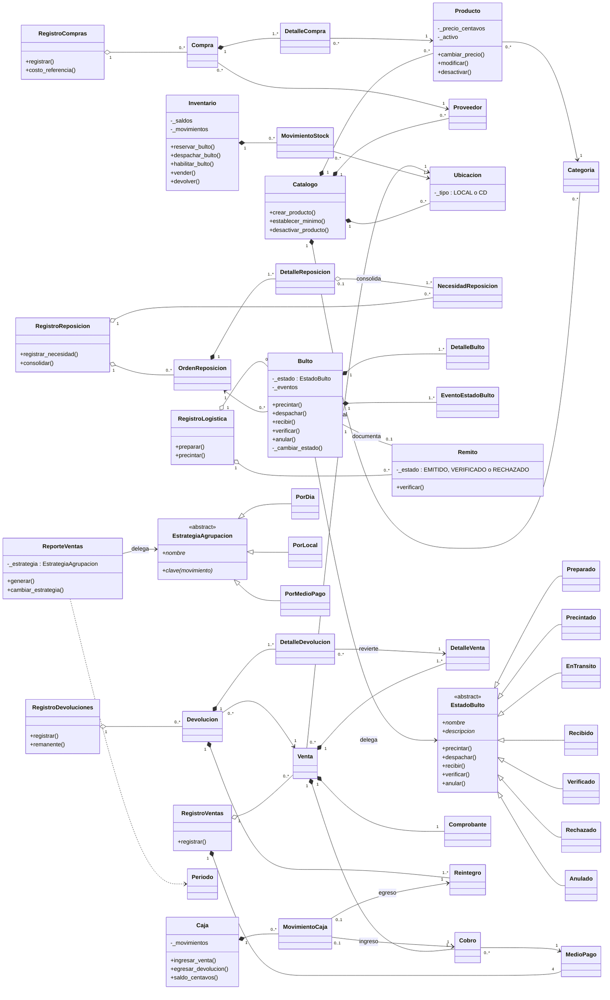

# Modelo POO implementado — revisión contra el código (F-07.3)

Revisión del modelo de objetos de `backend/dominio` realizada el 02/11/2026 sobre el código de `main` (T-26 de `PLANIFICACION_TP_POO.md`). Describe lo que el código hace hoy, lo compara con el UML preliminar (sección C de la planificación) y registra las observaciones que quedaron sin cambiar. Las afirmaciones que valen para todo el dominio se comprueban en `tests/test_modelo.py`; las reglas de cada clase, en los tests de su módulo (sección 9).

Es una decisión del grupo, no un modelo avalado por la cátedra. Las referencias «A §…» son secciones del `AGENTS.md` del repositorio, que resume el material de la cátedra.

## 1. Capas

| Capa | Ubicación | Responsabilidad |
| --- | --- | --- |
| Dominio | `backend/dominio` | Clases, reglas y patrones. No importa Flask ni SQLite. |
| Persistencia | `backend/persistencia` | Esquema, SQL parametrizado y transacciones con `sqlite3`; reconstruye los objetos con la API del dominio. |
| Adaptadores HTTP | `backend/api_*.py` | Validan el transporte JSON, envían el mensaje al dominio y confirman el cambio con `guardar_cambio`. |
| Presentación | `frontend/src` | Captura datos y muestra lo que devuelve Python; no decide reglas. |

Cada operación sigue el mismo recorrido: el adaptador busca los objetos, el dominio valida y modifica la memoria, y `guardar_cambio` (`backend/api_comun.py`) confirma en una transacción todas las filas de esa operación. Si la transacción falla, la memoria se reemplaza por el último estado confirmado.

## 2. Diagrama de clases

Se muestran las clases del dominio y sus relaciones principales; se omiten las propiedades de lectura, las excepciones y las clases de resultado de los reportes (sección 4.3).

## 3. Clases y responsabilidades

| Módulo | Clases | Responsabilidad |
| --- | --- | --- |
| `catalogo.py` | `Catalogo`, `Categoria`, `Producto`, `Proveedor`, `Ubicacion` | El catálogo crea y registra los maestros, reserva códigos históricos, controla un solo CD y guarda los mínimos por local. Cada maestro valida sus datos al crearse y al modificarse, y su baja lógica. |
| `compras.py` | `RegistroCompras`, `Compra`, `DetalleCompra` | Compra completa a un proveedor con destino el CD; el registro la confirma, ingresa el stock y calcula el costo de referencia (última compra). |
| `inventario.py` | `Inventario`, `MovimientoStock` | Único responsable de modificar saldos por ubicación, producto y condición; comprueba todos los saldos resultantes antes de aplicar y deja un movimiento por cambio. |
| `reposicion.py` | `RegistroReposicion`, `NecesidadReposicion`, `OrdenReposicion`, `DetalleReposicion` | Necesidades de un local y su consolidación en una orden CD → local, con lo solicitado, asignado y pendiente por producto. |
| `logistica.py` | `RegistroLogistica`, `Bulto`, `DetalleBulto`, `EventoEstadoBulto`, `Remito`, `EstadoBulto` y siete estados | Ciclo del bulto con State, historial de eventos, precinto único y remito con la segunda verificación. |
| `ventas.py` | `RegistroVentas`, `Venta`, `DetalleVenta`, `Cobro`, `Comprobante`, `MedioPago` | Venta multilínea con precio y costo históricos, cobros que suman el total y comprobante; clave de operación contra envíos repetidos. |
| `caja.py` | `Caja`, `MovimientoCaja` | Único responsable de registrar dinero: ingresos por cobro y egresos por reintegro; el saldo se calcula desde los movimientos. |
| `devoluciones.py` | `RegistroDevoluciones`, `Devolucion`, `DetalleDevolucion`, `Reintegro` | Devolución parcial de líneas de una venta, aptitud, reintegro por medio cobrado y control acumulado de lo devuelto. |
| `reportes.py` | `ReporteVentas`, `EstrategiaAgrupacion` y tres estrategias, `Periodo`; funciones `productos_mas_vendidos`, `existencias_y_minimos` y `rechazos_logisticos` | R-01 con Strategy y R-02 a R-04. Consultan los registros y devuelven objetos de resultado; no modifican nada. |
| `errores.py`, `catalogo.py`, `logistica.py` | `ConflictoOperacionError`, `CodigoDuplicadoError`, `CentroDistribucionDuplicadoError`, `ConflictoCatalogoError`, `TransicionBultoError` | Excepciones propias del dominio, que la API traduce a 409 (A §6.7). |

Los `Registro…` cumplen el papel de los servicios previstos en la planificación (C.2): asignan identificadores, coordinan las colaboraciones de una operación (por ejemplo `RegistroVentas.registrar` crea la venta y envía `vender` al inventario e `ingresar_venta` a la caja) y no absorben reglas propias de las entidades. La transacción SQLite queda fuera del dominio, en los adaptadores.

## 4. Encapsulamiento (A §6.9)

### 4.1 Estado interno y propiedades

- Todas las entidades y documentos guardan su estado en atributos con guion bajo y lo exponen con `@property` sin setter. Asignar, por ejemplo, `bulto.estado = "VERIFICADO"` o `venta.detalles = ()` produce `AttributeError`.
- Los cambios permitidos son mensajes con nombre del dominio (`modificar`, `cambiar_precio`, `desactivar`, `precintar`, `verificar`…) que validan todo antes de modificar la instancia.
- Cada validación está en el objeto responsable de su estado: `Producto` valida su precio, `Venta` que los cobros sumen el total, `Inventario` que ningún saldo quede negativo, `OrdenReposicion` que no se asigne más de lo pendiente.
- Las colecciones internas se exponen como tuplas (`detalles`, `cobros`, `eventos`) o mediante consultas (`listar_minimos`, `movimientos`): nadie recibe la lista interna para modificarla.
- Venta, compra y devolución se construyen completas y validadas: no existen documentos a medio confirmar ni operaciones para editarlos.

### 4.2 Métodos internos de colaboración

`Bulto._cambiar_estado`, `Bulto._fijar_precinto`, `Remito._rechazar`, `OrdenReposicion._agregar_bulto`, `NecesidadReposicion._consolidar` y los `_restaurar…` sólo los llaman otras clases del dominio o la persistencia al reconstruir datos confirmados. Python no impide llamarlos desde afuera: el guion bajo marca que no son parte de la interfaz pública, y los adaptadores HTTP no los usan.

### 4.3 Resultados de los reportes

`GrupoCaja`, `ResultadoVentas`, `FilaProducto`, `ResultadoProductos`, `FilaExistencia`, `ResultadoExistencias`, `BultoRechazado`, `RechazosLocal` y `ResultadoRechazos` tienen atributos públicos. Son la respuesta de una consulta: el reporte los arma y los devuelve, y la API los convierte en JSON. No guardan estado del sistema, así que modificarlos no altera stock, caja ni documentos. Es la única excepción a 4.1 y `tests/test_modelo.py` la fija por nombre.

## 5. Relaciones y cardinalidad (A §6.11)

Para cada relación todo/parte se aplicaron las dos preguntas del material: ¿la parte podría pasar a otro contenedor? y ¿tiene sentido sin ningún contenedor?

| Contenedor → parte | Tipo | Preguntas | En el código |
| --- | --- | --- | --- |
| `Compra` → `DetalleCompra`; `Venta` → `DetalleVenta`, `Cobro`, `Comprobante`; `Devolucion` → `DetalleDevolucion`, `Reintegro` | Composición | No y no: una línea o un cobro no se transfiere a otro documento ni existe sin él. | El documento crea sus partes en `__init__`, pasándose a sí mismo, y las guarda en tuplas. No hay remoción. |
| `OrdenReposicion` → `DetalleReposicion` | Composición | No y no. | La orden crea un detalle por producto a partir de sus necesidades. |
| `Bulto` → `DetalleBulto`, `EventoEstadoBulto` | Composición | No y no: el contenido y la historia son de ese bulto. | El bulto crea su contenido y el evento inicial; los demás eventos los agrega `_cambiar_estado`. No hay remoción ni edición. |
| `Catalogo` → maestros | Composición | No y no: cada maestro conserva la referencia a su catálogo, que reserva sus códigos. | `crear_…` crea y registra; la baja es lógica. |
| `Inventario` → `MovimientoStock`; `Caja` → `MovimientoCaja` | Composición | No y no. | Los crea `_aplicar`, `ingresar_venta` o `egresar_devolucion`; la persistencia los restaura con `restaurar_movimiento`, en orden. |
| `DetalleReposicion` → `NecesidadReposicion` | Agregación | La necesidad tiene sentido sin orden: el local la registra antes y queda pendiente. | La orden recibe necesidades ya existentes y las marca consolidadas; una necesidad consolidada no migra a otra orden. |
| `Registro…` → documentos | Agregación | Los documentos tienen identidad propia y la persistencia los construye antes de entregarlos con `restaurar`. | El registro asigna el identificador y no ofrece remoción. |

Asociaciones (sin pertenencia): los documentos con `Producto`, `Ubicacion`, `Proveedor` y `MedioPago`; `Producto` con su `Categoria`; `Bulto` con su `OrdenReposicion`; `Remito` con su `Bulto` (uno a uno, DN-01); `DetalleDevolucion` con la `DetalleVenta` que revierte, que admite varias devoluciones parciales; `MovimientoCaja` con el `Cobro` o el `Reintegro` que lo origina. Una clave foránea en SQLite no se tomó por sí sola como composición.

Cardinalidad: referencias simples para lo fijo (`venta.local`, `bulto.remito`, `compra.proveedor`) y colecciones para lo variable (líneas, cobros, eventos, movimientos). Las identidades se comparan con `is`: no se definieron `__eq__` ni operadores sin criterio del dominio (A §6.10).

## 6. Herencia, abstracción y polimorfismo (A §6.12 a §6.14)

- Las únicas jerarquías son los dos contratos abstractos con sus implementaciones y las excepciones. `Ubicacion` distingue Local y CD con un atributo `tipo` en lugar de dos subclases, porque ambos tienen los mismos datos y operaciones; lo que cambia es qué operaciones aceptan (el CD no vende ni tiene mínimos), y eso lo controla quien recibe la ubicación.
- `EstadoBulto` y `EstrategiaAgrupacion` derivan de `ABC` y declaran `@abstractmethod`: no se instancian, y cada clase concreta implementa `nombre` (y `descripcion` o `clave`).
- `EstadoBulto` es una clase abstracta con comportamiento común concreto: por defecto toda operación llama a `_rechazar`, y cada estado redefine (sobreescribe) sólo las que admite.
- Ninguna derivada redefine `__init__`, así que no hace falta `super()` en el dominio. Se usa en `ErrorCatalogoAPI`, que extiende la inicialización de `Exception`.
- Polimorfismo: el bulto envía el mismo mensaje a cualquier estado y el reporte envía `clave(movimiento)` a cualquier estrategia, sin `if`/`isinstance` sobre la clase concreta (A §6.13).

## 7. Patrones de diseño (RT-04)

### 7.1 State: ciclo de vida del bulto

**Problema.** Las operaciones válidas sobre un bulto dependen de su estado, y una secuencia incorrecta (recibir sin despachar, verificar un bulto rechazado) habilitaría mercadería no verificada. El enunciado evalúa críticamente este ciclo y exige su trazabilidad inmutable.

**Objetos.** `Bulto` es el contexto: guarda una referencia a un objeto estado en `_estado` y cada operación pública es una sola instrucción que delega pasándose a sí mismo, por ejemplo `self._estado.verificar(self, instante)`. `EstadoBulto` es el contrato. Cada estado concreto decide si acepta la operación, pide al inventario el efecto de stock que corresponde y solicita la transición con `bulto._cambiar_estado(...)`, único lugar que cambia el estado y siempre agrega un evento.

| Estado | Operación admitida | Efecto | Estado siguiente |
| --- | --- | --- | --- |
| `Preparado` | `precintar` | Fija precinto y remito emitido | `Precintado` |
| `Preparado` | `anular` | Libera la reserva del CD | `Anulado` |
| `Precintado` | `despachar` | Reserva del CD → en tránsito al local | `EnTransito` |
| `EnTransito` | `recibir`, precinto íntegro y coincidente | En tránsito → pendiente en el local | `Recibido` |
| `EnTransito` | `recibir`, precinto roto o distinto | En tránsito → rechazado; remito rechazado | `Recibido` y `Rechazado` en la misma operación |
| `Recibido` | `verificar` | Ninguno: falta el remito | `Verificado` |
| `Verificado`, `Rechazado`, `Anulado` | ninguna | — | estados finales |

Cualquier otra combinación dispara `TransicionBultoError` (409 en la API) sin cambiar nada. La segunda verificación la hace `Remito.verificar`, que exige el bulto `Verificado` y recién entonces pasa el stock de pendiente a disponible: verificar sólo el bulto o sólo el remito nunca habilita la venta (RB-01). El remito no usa State: desde `EMITIDO` sólo puede cerrarse una vez, como `VERIFICADO` con su propia operación o como `RECHAZADO` por el rechazo de su bulto, y no tiene más estados.

**Consecuencias.** Agregar un estado es agregar una clase sin tocar el contexto; las reglas de cada estado quedan juntas; la historia se conserva aunque el bulto deje de operar, y en SQLite dos triggers impiden `UPDATE` y `DELETE` de `eventos_bulto`. Como contrapartida hay siete clases pequeñas, y la pantalla también consulta el nombre del estado para elegir qué botones mostrar: es sólo presentación, porque Python vuelve a decidir y rechaza la operación no admitida.

### 7.2 Strategy: agrupación de R-01

**Problema.** R-01 calcula cobros, reintegros e ingreso neto del período y debe poder agruparlos por día, por local o por medio de pago, siempre sobre el mismo conjunto de movimientos de caja.

**Objetos.** `ReporteVentas` es el contexto: filtra los movimientos del período y del local y delega en `self._estrategia.clave(movimiento)` a qué grupo pertenece cada uno. `EstrategiaAgrupacion` es el contrato y `PorDia`, `PorLocal` y `PorMedioPago` las estrategias. El cliente elige la estrategia desde afuera: la API la toma de `ESTRATEGIAS_AGRUPACION` según el parámetro `agrupacion` y la pasa al constructor; también puede reemplazarse con `cambiar_estrategia`.

**Consecuencias.** El contexto no contiene un `if`/`elif` por agrupación; una agrupación nueva es una clase nueva. La estrategia no modifica datos ni decide transiciones: sólo calcula una clave (T-28). La guía de patrones reconoce que con tres agrupaciones un condicional también funcionaría; se eligió el patrón porque las agrupaciones son algoritmos intercambiables sobre los mismos datos, que es el caso que describe Strategy, y porque el enunciado pide al menos dos patrones aplicados a problemas reales.

### 7.3 Patrones no aplicados

- **Singleton:** no hay una necesidad de instancia única. Cada `create_app` tiene sus propios registros y su `Lock`, lo que permite que cada prueba use una aplicación y una base aisladas.
- **Factory, Observer e Iterator:** no se identificó un problema del dominio que los requiera. Las colecciones se exponen como tuplas, que ya son iterables, y ninguna operación notifica cambios a suscriptores.

## 8. Diferencias con el UML preliminar (planificación C.2 a C.4)

| Preliminar | Implementado | Motivo |
| --- | --- | --- |
| `Existencia` por ubicación, producto y condición | `Inventario` con un diccionario de saldos y `MovimientoStock` | Un solo responsable que comprueba todos los saldos de una operación antes de aplicar alguno. La tabla `existencias` conserva la forma prevista. |
| `ServicioCompras`, `ServicioLogistica`, `ServicioVentas` | Los `Registro…` del dominio y la transacción en `guardar_cambio` | La coordinación entre objetos queda en el dominio y la transacción en el adaptador, sin una capa adicional. |
| Seis estados del bulto | Siete: se agregó `Anulado` | Permite deshacer una preparación y liberar la reserva sin borrar el bulto (sección M de `DECISIONES_F00.md`). |
| `Remito` con uno o más bultos | Un remito por bulto, emitido al precintar | DN-01 aprobada. |
| `Venta` asociada con `Cobro` | Composición | Los cobros se crean con la venta y deben sumar su total. |
| `EstrategiaAgrupacion.agrupar(datos)`; `PorPeriodo` | `clave(movimiento)`; `PorDia` | La estrategia sólo decide el grupo y el contexto acumula; el período es un filtro (`Periodo`), y la agrupación temporal es por día. |
| `ConsultasReportes` | Funciones de `reportes.py` para R-02 a R-04 | Son cálculos sin estado propio; una clase no aportaba responsabilidad. |
| Sin caja como clase | `Caja` y `MovimientoCaja` | Único responsable del dinero, con saldo por local y medio. |
| Sin `Periodo` | `Periodo` | Valida el intervalo con inicio incluido y fin excluido y lo comparten los cuatro reportes. |

## 9. Verificación

`tests/test_modelo.py` inspecciona el código con `ast` y comprueba:

- que las únicas jerarquías son `EstadoBulto` con sus siete estados, `EstrategiaAgrupacion` con sus tres estrategias y las excepciones, y que ambos contratos declaran métodos abstractos;
- que sólo las clases de resultado de 4.3 asignan atributos públicos y que el dominio no usa `setattr`;
- que cada parte compuesta de la sección 5 la crea únicamente su contenedor, en todo `backend`;
- que cada operación del bulto es una delegación de una instrucción en `self._estado`, que `Bulto` sólo nombra a `Preparado` (su estado inicial), que `ReporteVentas` no nombra ninguna estrategia concreta y que sólo el bulto asigna su `_estado`.

Para comprobar que las pruebas detectan violaciones, se ejecutaron sobre una copia del backend con un atributo público en `Venta`, una cadena `isinstance` en `Bulto.verificar`, un `DetalleVenta` creado en la persistencia y una subclase de `Ubicacion`: fallaron las cinco pruebas correspondientes.

El comportamiento de cada clase ya estaba probado: estado protegido con `AttributeError` en `test_catalogo.py`, `test_proveedores.py`, `test_ubicaciones.py`, `test_minimos.py`, `test_bajas.py`, `test_compras.py`, `test_ventas.py`, `test_devoluciones.py` y `test_logistica.py`; contratos abstractos en `test_logistica.py` y `test_reportes.py`; transiciones válidas e inválidas de cada estado (T-27) en `test_logistica.py`; intercambio de estrategias sobre los mismos datos (T-28) en `test_reportes.py`; e independencia del dominio respecto de Flask y SQLite en `test_catalogo.py`.

## 10. Observaciones pendientes

No se modificó código durante la revisión. Quedan registradas:

- Los métodos con guion bajo de 4.2 dependen de una convención; si el docente pide un encapsulamiento más estricto entre clases del dominio, habría que revisarlos.
- `Remito.verificar` y `DetalleReposicion.cantidad_asignada` consultan el nombre del estado del bulto (`"VERIFICADO"`, `"ANULADO"`). Es una pregunta al colaborador, no una selección de comportamiento, pero acopla esas clases a los nombres de los estados.
- Los identificadores se asignan con la cantidad registrada más uno; por eso la persistencia restaura cada registro en orden, y los `restaurar…` lo exigen.
- No hay `__str__` en el dominio: la representación textual la arman la API y la pantalla.
