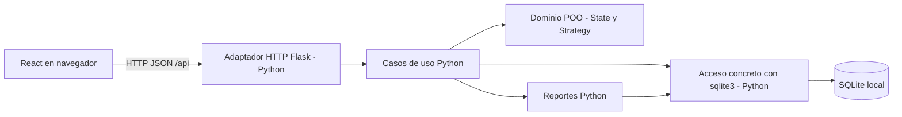

# Propuesta de arquitectura React + Python — DN-10

Fecha: 19 de octubre de 2026. Audiencia: equipo del TP Integrador DAO 2026, Tema 3.

**Estado: arquitectura acordada para planificación y sincronizada el 19/10/2026, sin implementación.** React + Vite en navegador, API HTTP/JSON Flask y backend exclusivamente Python, SQLite mediante `sqlite3`. El pedido posterior de alinear las tres documentaciones adopta esta base; no constituye aval docente ni autorización de F-01. No hay código, instalaciones ni comandos de aplicación verificados.

## 1. Objetivo, fuentes y estado de las decisiones

Documentar la arquitectura vigente de DN-10 preservando POO, reglas académicas y simplicidad. El pedido de sincronización autoriza editar este documento, la planificación y F-00; no autoriza iniciar F-01 ni modificar AGENTS.md o el enunciado.

| Referencia | Fuente y alcance comprobado |
| --- | --- |
| E | [tema3.pdf](<C:/Users/Tommy/Documents/cosas de la facultad/4to/DAO/TP-DAO/docs/tema3.pdf>), dos páginas: Contexto y siete procesos obligatorios en p. 1; cinco validaciones, reportes sugeridos y Consideraciones particulares en p. 2. |
| A | [AGENTS.md](<C:/Users/Tommy/Documents/cosas de la facultad/4to/DAO/TP-DAO/AGENTS.md>): autoridad §2; progresión §§3/4; POO §§6.8 a 6.14; pytest §6.15; patrones §§6.16 a 6.20; SQLite §§6.21 a 6.23; límites y simplicidad §§8/9; verificación §10. |
| P | [PLANIFICACION_TP_POO.md](<C:/Users/Tommy/Documents/cosas de la facultad/4to/DAO/TP-DAO/docs/PLANIFICACION_TP_POO.md>): requisitos B; modelo C; arquitectura D/E; datos F; flujos/reportes G; fases I; pruebas J; decisiones K.1. |
| D | [DECISIONES_F00.md](<C:/Users/Tommy/Documents/cosas de la facultad/4to/DAO/TP-DAO/docs/DECISIONES_F00.md>): hallazgos B; DN-10/DN-11 en C; alternativas D; acuerdo vigente E; pendientes F a J. |
| U-RP | Pedido anterior de evaluar React + Vite, API Python, SQLite y HTTP/JSON; prohíbe backend/SSR/BFF/negocio Node. |
| S | Pedido posterior de sincronizar las documentaciones con las mismas decisiones: adopción documental de esta arquitectura, incluyendo Flask. Autoriza editar P/D/R sin implementación. |

Las cuatro fuentes se leyeron durante esta conversación; se comprobó su contenido actual y la nueva ubicación de las fuentes en `docs/`. El PDF se extrajo nuevamente; su contenido coincide con el original previamente revisado visualmente. No se atribuye lectura directa a los seis materiales académicos que A §15 enumera y que no están en el repositorio.

Clasificación de evidencia:

- **Confirmado:** requisitos de E/A, restricciones U-RP/S y ausencia actual de aplicación/manifiestos/pruebas.
- **Acordado para planificación:** AC-01 a AC-07, incluyendo React + Vite, Flask, proxy de desarrollo y build servido por Python; acuerdo del usuario por S, sin aval académico atribuido.
- **Propuesto:** puertos concretos, contrato detallado de errores y demás detalles de implementación aún no acordados.
- **Inferido:** una instalación académica local permite demostrar los procesos con varios locales lógicos.
- **Supuesto pendiente:** experiencia del equipo, concurrencia requerida, condiciones adicionales de entrega y aceptación académica específica si existe una regla no aportada.

P D/E y D E reflejan ahora la misma opción C: React + Vite y API Flask Python. Las preferencias anteriores por consola/web renderizada son antecedentes sustituidos como base. Esta sincronización corrige estados y referencias de los tres documentos; no cierra políticas de dominio ni implementa componentes.

## 2. Drivers y restricciones

Prioridad alta: cumplir el dominio de E, sostener POO visible y explicable, mantener toda autoridad del negocio en Python, conservar trazabilidad/atomicidad y respetar la preferencia React + Vite. Prioridad media: interfaz clara para demostración, pocas dependencias adicionales, pruebas aisladas y ejecución local reproducible. No hay requisitos confirmados de alta carga, nube, múltiples instalaciones o sincronización.

| Restricción | Consecuencia arquitectónica |
| --- | --- |
| Siete procesos y cinco validaciones de E | La interfaz cubre los flujos existentes; no sustituye compras, reposición, logística, ventas, cobros, comprobantes o devoluciones por pantallas sin comportamiento. |
| Remito y bulto Verificados antes de stock Disponible; precinto roto implica Rechazado | Decisión en dominio/caso de uso Python y efecto persistente atómico. Ocultar un botón React no satisface esta validación. E, p. 2, primera validación. |
| Historia inmutable del ciclo del bulto | Guardar eventos originales; React los consulta. No se expone edición libre de estado o historial. E, p. 2, segunda validación; A §6.9. |
| Dos patrones y cuatro reportes no triviales | Mantener State y Strategy como propuestas justificadas en Python; las agrupaciones visuales no cuentan por sí solas como patrones ni como cuatro reportes. E, p. 2; P C.5/C.6/G.11; D B.3. |
| Backend exclusivamente Python | API, servicios, reglas, cálculos definitivos, acceso a DB, validaciones servidor y tareas de aplicación en Python. SQL permitido para persistencia. |
| Node.js limitado al frontend | Puede ejecutar Vite, herramientas de construcción y soporte de desarrollo de la UI. Prohibidos SSR, BFF, endpoints de aplicación, lógica de negocio y acceso SQLite desde Node. |
| SQLite directo | Módulo `sqlite3`, SQL parametrizado, transacciones, referencias y cierre de recursos; no ORM ni servidor de base adicional. A §§6.21 a 6.23. |

A §§3/8 indica que las GUI no están desarrolladas en el material incorporado; no establece una prohibición universal. Ni Flask ni FastAPI se presentan como tecnología exigida o avalada expresamente por la cátedra. Su viabilidad técnica es distinta de una condición académica específica por confirmar si aparece (D B.1 H-01 y G-05).

### 2.1 Acuerdos arquitectónicos vigentes

| ID | Decisión vigente |
| --- | --- |
| AC-01 | Frontend React + Vite ejecutado en navegador; `npm run dev` durante desarrollo. |
| AC-02 | API HTTP/JSON con Flask y backend exclusivamente Python; prefijo `/api`. |
| AC-03 | Persistencia SQLite mediante `sqlite3` y SQL directo parametrizado. |
| AC-04 | Desarrollo con proxy transparente de Vite hacia Python, conservando `/api` y sin lógica de aplicación en Node. |
| AC-05 | `npm run build` genera estáticos; para demostración local Python sirve frontend compilado y API desde el mismo origen. |
| AC-06 | Prohibidos backend, SSR, BFF, reglas de negocio y acceso a DB desde Node.js; Node se limita a herramientas/frontend. |
| AC-07 | Dominio POO, cálculos definitivos, validaciones y transacciones en Python; React presenta e informa la intención del usuario. |

Los mismos identificadores/valores figuran en P D.2 y D E.1. Versiones, JS/TS, contratos por caso y modalidad DN-11 siguen pendientes; no se vuelve a elegir frontend o framework API.

## 3. Alternativas y selección de framework

La alternativa histórica de web renderizada desde Python reduce coordinación cliente/servidor y sigue siendo viable; no aprovecha la preferencia actual por React + Vite. La opción recomendada conserva **un único backend modular**, acompañado por un frontend separado lógicamente. No requiere microservicios ni despliegues independientes.

### 3.1 Flask frente a FastAPI para esta API

| Criterio | Flask | FastAPI |
| --- | --- | --- |
| HTTP/JSON | Rutas y respuestas JSON con un flujo explícito; suficiente para los casos del TP. | Orientado a API, contratos basados en tipos y esquemas de entrada/salida. |
| Validación del transporte | Parseo y comprobaciones explícitas; más trabajo manual para formatos/errores. No requiere otra biblioteca de esquemas para empezar. | Pydantic valida datos y ayuda a describir el contrato. Esa validación no sustituye stock, transiciones ni reglas de devolución del dominio. |
| Documentación de API | Debe documentarse y mantenerse de forma explícita si no se agregan extensiones. | Genera especificación OpenAPI e interfaces de documentación a partir de las declaraciones. |
| Simplicidad académica | Pocas abstracciones propias para rutas síncronas; facilita mostrar Python/POO y SQL directo. Puede terminar con rutas demasiado grandes si no delegan. | Reduce trabajo repetitivo de contrato, pero agrega modelos de transporte, tipado y convenciones del framework que deben poder explicarse. |
| SQLite/sqlite3 | Encaja con operaciones síncronas y conexión acotada al contexto de la solicitud. | También compatible. Admite funciones síncronas; no obliga a escribir `async`. Debe cuidarse el uso de conexiones en su ejecución por hilos. |
| Herramientas adicionales | Framework WSGI y su ecosistema; no se propone Flask-RESTful, ORM ni una colección de extensiones. | Ecosistema ASGI, Starlette y Pydantic; no se necesita incorporar ORM ni drivers asíncronos. |
| Pruebas | Cliente de prueba del framework con pytest; dominio testeable sin Flask. | Cliente de prueba y contratos declarados; dominio igualmente independiente. |
| Adecuación al pedido | Cumple backend Python y API JSON. | Cumple las mismas restricciones. No se descarta por ser contenido adicional. |

Capacidades técnicas contrastadas con documentación primaria: [Flask, API JSON](https://flask.palletsprojects.com/en/stable/quickstart/#apis-with-json), [FastAPI, características y validación](https://fastapi.tiangolo.com/features/), [FastAPI, funciones síncronas y ejecución](https://fastapi.tiangolo.com/async/#path-operation-functions). La evaluación de simplicidad de la tabla es un juicio para este TP, no una afirmación de superioridad general ni una medición de rendimiento.

**Decisión vigente: Flask con rutas síncronas como adaptador HTTP delgado.** El TP ya necesita explicar objetos, estados, persistencia y transacciones; no requiere asíncronía ni generación automática de documentación. El costo aceptado es escribir el contrato y las validaciones de transporte con cuidado. No se recomienda un framework sólo para reducir la cantidad de líneas.

**Cuándo reconsiderar a favor de FastAPI:** si el equipo ya lo conoce o valora sus esquemas/OpenAPI lo suficiente para compensar los conceptos añadidos. Mantener entonces los modelos Pydantic como datos de entrada/salida, separados de Bulto, Venta y demás objetos de dominio; usar operaciones síncronas para `sqlite3` y definir la propiedad de conexión sin compartirla inadvertidamente entre hilos. No hace falta aprender o introducir `async/await` por elegir FastAPI. Flask ya está acordado para planificación; cambiar a FastAPI requeriría una revisión justificada de DN-10 y sus contratos, no resolver una selección aún abierta.

## 4. Arquitectura recomendada y responsabilidades

El diagrama muestra límites lógicos. El proxy de desarrollo y el servidor de estáticos de las secciones siguientes son infraestructura de presentación, no otro dominio/backend.

| Responsable | Funciones | Límite que debe respetar |
| --- | --- | --- |
| React | Formularios, navegación, selección de local, tablas/reportes, historial visual, estados de carga/error y confirmación. Conserva borradores de entrada y datos consultados. | No persiste inventario/caja como fuente de verdad ni decide disponibilidad, margen definitivo o reintegros. Los componentes funcionales son compatibles: la POO evaluada se mantiene en Python. |
| Cliente HTTP del frontend | Centraliza solicitudes JSON, interpreta éxito/error, muestra problemas de red y refresca datos después de confirmar. Puede usar `fetch` del navegador sin otra biblioteca HTTP. | No contiene reglas de negocio ni un SDK que reproduzca el modelo Python. No reintenta escrituras automáticamente ante una respuesta incierta. |
| API Python | Recibe HTTP, comprueba formato/tipos de transporte, convierte datos explícitos, llama un caso de uso y traduce resultado/excepciones a JSON/HTTP. | No concentra todo el negocio en las rutas ni serializa indiscriminadamente atributos internos de los objetos. |
| Casos de uso Python | Coordinan entidades, saldos, documentos y transacción. Releen información al confirmar y devuelven el resultado persistido. | Una operación comercial/logística completa no se divide en varias llamadas cliente con commits independientes. |
| Dominio POO Python | Invariantes de entidades, composición de detalles, transiciones State, política Strategy y cálculos acordados. | Independiente de React, Flask/FastAPI, JSON y `sqlite3`. Nada de setters públicos genéricos para saltar el ciclo del bulto. |
| Persistencia Python | Abre/cierra conexiones; parámetros SQL; carga objetos; guarda saldos, documentos e historia. | El único acceso a SQLite desde la aplicación pasa por Python. No se crea un repositorio abstracto o una clase por tabla sin necesidad. |
| Reportes Python | Filtros, agregaciones, ranking, margen estimado, mínimos y rechazos con las fórmulas acordadas. | React presenta resultados y puede ordenar visualmente; no reconstruye los cuatro reportes a partir de datos crudos como única implementación. |

Se conserva el modelo de P C/F y las precisiones de D B.3: Bulto controla contenido/estado, los documentos componen sus líneas y los productos/proveedores/ubicaciones conservan identidad independiente. Remito tiene verificación propia. State delega por estado; Strategy cambia el algoritmo elegido sobre un conjunto de datos definido. JSON y componentes React no reemplazan esos contratos ni prueban por sí solos POO (A §§6.8 a 6.20).

### 4.1 Autoridad de datos y atomicidad

SQLite es la fuente persistente; los objetos cargados por Python aplican reglas sobre datos actuales. React mantiene una vista temporal que puede quedar desactualizada. Tras una escritura confirmada, la UI actualiza sus datos desde la respuesta o una nueva consulta. No se ofrece “venta exitosa” antes de confirmar en servidor.

Cada ingreso, preparación/reserva, despacho, recepción/verificación, venta o devolución conserva la unidad de trabajo de P F.4. Cabeceras, líneas, estados, eventos y efectos sobre stock/caja se confirman juntos cuando pertenecen a la misma acción. No se mantiene una transacción durante toda una sesión de navegador. Fallo de persistencia implica rollback y descarte/recarga de objetos mutados (A §6.23; D E.2).

Conexiones de vida acotada a solicitud/operación, creadas y usadas bajo propiedad explícita; cierre incluso ante error, sin confundir cierre con commit. No usar una conexión global ni Singleton compartido entre solicitudes. Revalidar stock y actualizarlo dentro de la misma transacción; dos pestañas pueden solapar solicitudes incluso con un operador local. No desactivar `check_same_thread` como solución automática. Parámetros, unicidad y claves foráneas complementan las invariantes Python.

Este uso acotado está respaldado por [Flask y SQLite por contexto](https://flask.palletsprojects.com/en/stable/patterns/sqlite3/) y [sqlite3: conexiones y transacciones](https://docs.python.org/3/library/sqlite3.html). La modalidad exacta de control transaccional y versión de Python se fijará al implementar; no se depende silenciosamente de los valores predeterminados de una versión no elegida.

## 5. Ejecución local y comunicación durante desarrollo

### 5.1 Dos procesos, un solo backend de aplicación

| Proceso propuesto | Dirección propuesta | Propósito |
| --- | --- | --- |
| Vite, iniciado mediante `npm run dev` | `http://127.0.0.1:5173` | Servir la interfaz de desarrollo, transformar módulos y actualizar la UI durante edición. Se configurarán host/puerto de forma explícita. |
| API Python con Flask | `http://127.0.0.1:5000` | Atender casos de uso HTTP/JSON y acceder a SQLite. El comando usará el módulo/fábrica real que se cree posteriormente; hoy no existe entrypoint para ejecutarlo. |
| Navegador | Abre la URL de Vite | Ejecutar React/JavaScript del frontend. No abre el archivo SQLite. |

Los puertos son una propuesta de coordinación, no un entorno ya comprobado. Vite puede buscar otro puerto si el solicitado está ocupado; se recomienda configuración estricta para fallar de forma visible. Elegir versiones de Node/npm, React/Vite y Python/framework compatibles al implementar, sin imponer ahora un número no verificado para el entorno del equipo. React/Vite y sus paquetes son herramientas/frontend; no autorizan negocio en Node.

### 5.2 Camino acordado: proxy transparente de Vite

El navegador utiliza rutas relativas bajo `/api`. Vite reenvía ese prefijo a la API Python, **conservando el prefijo**, el cuerpo JSON y el resultado; Python publica su API bajo el mismo espacio. No se agregan handlers de negocio, middleware de aplicación, agregación de respuestas, autorización ni consultas DB en el proceso Node. Así el navegador usa el origen de Vite y la comunicación con Python es un reenvío de desarrollo, no un BFF.

Comparación de comunicación:

| Opción | Ventajas | Costo/límite |
| --- | --- | --- |
| Proxy transparente de Vite, acordado | Cliente usa `/api` también en el build servido por Python; evita habilitar CORS para ese flujo. | Sólo existe durante desarrollo; se debe configurar sin quitar prefijo ni añadir lógica de aplicación. |
| Navegador llama directamente al puerto Python | El tráfico llega directamente a la API, útil para probar o si el equipo prefiere evitar proxy. | Cambia el origen por puerto; Python debe permitir explícitamente el origen del frontend y responder a preflight cuando corresponda. Requiere gestionar la URL base. |

No mezclar ambos caminos sin necesidad. En modo directo, usar una lista de orígenes concretos; CORS no autentica usuarios ni protege por sí solo las operaciones. En modo proxy no hace falta añadir CORS de forma preventiva. Si cambia host/puerto, deben coincidir URL y política. Referencias: [Vite, proxy/puerto de desarrollo](https://vite.dev/config/server-options/#server-proxy) y [orígenes y CORS](https://fastapi.tiangolo.com/tutorial/cors/).

El proxy no debe convertirse en un requisito para el backend: las reglas se verifican también llamando directamente a Python. Si Node necesita consultar stock, validar ventas o calcular resultados para contestar `/api`, se incumple U-RP.

### 5.3 Secuencia de uso prevista

1. En una fase futura autorizada, preparar los entornos y versiones acordados; no se realizan instalaciones en esta revisión.
2. Iniciar Python con una DB local de demostración aislada de tests; comprobar que abrió la ruta correcta.
3. Iniciar `npm run dev` en el proyecto frontend futuro y abrir su URL. Ese script debe declararse en el manifiesto real; hoy no existe `package.json`.
4. Ejecutar los flujos desde React; API recibe acciones y devuelve resultados persistidos. Si Python no responde, mostrar error y conservar el formulario sin afirmar éxito.
5. Cerrar procesos sin tareas de escritura pendientes; comprobar persistencia al reiniciar en la fase de verificación.

Los comandos npm de esta propuesta son convenciones documentadas, **no comandos ejecutables del repositorio actual ni comprobaciones ya corridas**. No se inventa una ruta de entrada Python. El servidor de desarrollo se limita a loopback; una demostración por LAN o publicación exige revisar DN-11 y controles de acceso.

## 6. Compilación y ejecución del frontend compilado

En implementación se declarará el script acordado `npm run build` que invoque Vite y genere recursos estáticos, normalmente en `dist`. El navegador seguirá ejecutando React; no se generará un servidor Node ni se usará SSR. La compilación puede necesitar Node/npm, pero el paquete estático final puede ejecutarse servido por Python sin Node instalado en la máquina de demostración.

**Modalidad acordada de demostración local, sujeta al alcance operativo de DN-11:** Python atiende `/api` y sirve el HTML/JS/CSS compilado desde el mismo origen. La separación frontend/backend se conserva en responsabilidades y construcción; no exige dos procesos de aplicación durante la demostración. El directorio de estáticos distribuido no contiene SQLite, código/configuración privada del servidor ni dependencias backend.

El proxy de `npm run dev` no se incorpora al build. Por eso las solicitudes relativas `/api` deben llegar a la API real en la modalidad final. Si después se aprueba alojar frontend y API en orígenes distintos, definir URL base y CORS para ese caso; no suponer que la configuración de desarrollo resuelve el despliegue.

Si se eligen rutas cliente con historial, Python deberá servir el documento de la SPA al navegar directamente por una ruta de UI. Esa recuperación nunca debe capturar `/api`, convertir errores API en HTML ni esconder estáticos faltantes. Un menú/pantalla simple puede evitar incorporar router inicialmente; no se agrega una librería de navegación sin necesidad.

`npm run preview` sirve para revisar localmente el build si se declara ese script; no se adopta como servidor de entrega/producción. Validar el build con el servidor Python previsto y con Vite apagado, incluyendo recarga de pantalla y consultas API. Referencia: [Vite, build estático y preview](https://vite.dev/guide/static-deploy.html).

No colocar claves, rutas privadas de DB o secretos en variables expuestas al cliente; la configuración de frontend se incorpora al contenido que recibe el navegador. La base operativa se ubica fuera de los recursos públicos, con una ruta definida por Python. Referencia: [Vite, variables de entorno](https://vite.dev/guide/env-and-mode.html).

## 7. Contratos HTTP/JSON y validaciones

### 7.1 Contrato por acordar antes de cada incremento

El prefijo `/api` es una propuesta de espacio de nombres, **no una lista de endpoints existentes**. Antes de implementar un caso, registrar sus entradas, resultado, errores y efectos. No se inventan rutas completas ni se promete OpenAPI automático con Flask.

| Aspecto | Política propuesta |
| --- | --- |
| Acciones | Consultas sin efectos y comandos del dominio para preparar, precintar, despachar, recibir/verificar, vender o devolver. No un PATCH genérico que acepte saldo/estado/historia arbitrarios. |
| Datos intercambiados | Objetos JSON explícitos con identificadores, cantidades, fechas e importes según DN-02/DN-06/DN-09. El cliente no envía precio/costo final, total o disponibilidad como autoridad. |
| Dinero | Acordar escala exacta. Si se usan enteros de unidad mínima, limitar al rango seguro compartido con JavaScript; si se usa Decimal, transportar una representación textual acordada. Evitar redondeo financiero definitivo en React. |
| Fechas | Formato y zona explícitos, siguiendo DN-09. Definir límites de período y no reinterpretarlos sólo en el navegador. |
| Resultado | Respuesta identifica el documento persistido y los datos necesarios para actualizar la vista. Una respuesta de éxito sigue al commit, no al clic. |
| Error | Forma JSON consistente con código estable, mensaje comprensible y campos afectados cuando aplique. Detalle interno en diagnóstico servidor; sin traceback/SQL en la respuesta. |
| Estados HTTP | Propuesta: 400 para JSON/datos de entrada inválidos; 404 para referencia inexistente; 409 para conflicto de duplicado, stock o estado actual; 500 para fallo inesperado. Los demás casos se acuerdan por contrato. Si se elige FastAPI, explicitar también su tratamiento de errores de validación, sin asumir la misma respuesta por defecto. |
| Repetición | Recepción/verificación/despacho repetidos no duplican efectos. Para venta/devolución, acordar identificación única de la operación y conducta ante reenvío antes de F-04/F-05. Un fallo de red tras commit no demuestra que la operación haya fallado. |

Evitar dividir una venta en solicitudes independientes que primero descuentan stock, luego cobran y después crean comprobante. El cliente envía una intención; Python confirma la unidad de trabajo. La reconsulta/reimpresión usa la operación existente y no la ejecuta otra vez (P F.4/G.8; D DN-05).

### 7.2 Tres niveles de validación, una autoridad de negocio

| Nivel | Responsabilidad |
| --- | --- |
| React | Ayuda de entrada: campos requeridos, formato visible, mensajes, deshabilitar envío durante solicitud y confirmar intención. Son ayudas; se pueden eludir y pueden usar datos desactualizados. |
| Adaptador HTTP Python | JSON válido, tipos, campos y formato del contrato. Traduce a parámetros explícitos para casos de uso; no reemplaza el dominio con decoradores/esquemas. |
| Dominio/casos de uso y DB | Entidades protegen invariantes; casos de uso verifican referencias, stock actual, documentos y política acordada dentro de transacción. SQL impide duplicados/referencias inválidas según esquema. |

Las cinco validaciones de E se deben mantener aunque se omita completamente React: doble verificación y rechazo, historia inmutable, límite de venta, duplicados y devolución válida. Agregar React no resuelve las políticas pendientes de remito, compras o devoluciones (D DN-01 a DN-09).

## 8. Estrategia de pruebas y evidencia futura

Se conserva pytest y el catálogo de P J, ampliando la superficie HTTP/navegador. No se impone cobertura porcentual, CI, mocks o fixtures por considerarlos exigencias académicas; A §§6.15/8 no los establece. Hoy no hay suite ni aplicación para ejecutar.

| Nivel | Evidencia prevista y casos relevantes |
| --- | --- |
| Dominio Python | pytest: objetos válidos/inválidos, unidades, composición, mismo mensaje sobre estados, transiciones prohibidas, historia y estrategias intercambiables. Sin levantar HTTP ni React. P T-01 a T-03, T-13, T-26 a T-28. |
| Persistencia/casos de uso | SQLite temporal aislado, unicidad, parámetros, FK, reapertura, commit y rollback. Dos operaciones que disputan el último disponible no deben ambas venderlo. Fallos no dejan media venta/devolución ni eventos sin saldo correspondiente. P T-05/T-15/T-20/T-25/T-30. |
| API Python | pytest con cliente de prueba Flask: JSON mal formado, datos inválidos, inexistente/duplicado, conflicto y éxito; contenido y estado HTTP; comprobación de la DB posterior. Mismas prohibiciones llamando directamente a API y sin frontend. [Cliente de prueba Flask](https://flask.palletsprojects.com/en/stable/testing/#sending-requests-with-the-test-client). |
| Interfaz React | Campos/mensajes, carga, conflicto de stock, backend caído, doble clic y recuperación del borrador. Recorrido manual reproducible al inicio; automatizar componentes con estado relevante si aporta valor. Elegir runner/biblioteca frontend sólo cuando se definan esas pruebas; no se añade una dependencia obligatoria ahora. |
| Desarrollo integrado | Navegador→Vite/proxy→Python→SQLite: catálogo, compra, dos necesidades consolidadas, bulto, despacho y recepción. Bulto sólo o remito sólo Verificado sigue bloqueado; precinto roto rechaza; ambos conformes habilitan una vez. P T-06 a T-12 y J.4. |
| Venta/devolución y reportes | Venta de una/múltiples líneas, última unidad, insuficiencia, pago acordado, comprobante reconsultado, devolución inválida/parcial y cuatro reportes sobre dataset conocido. Distinguir ventas/caja/margen, evitar multiplicación por líneas×cobros y conservar costo histórico. P T-14 a T-24; D B.3. |
| Build y distribución | Cuando existan scripts, ejecutar build y cargarlo desde Python con Vite/Node de desarrollo apagados. Verificar activos, refresco de rutas de UI, errores JSON bajo `/api`, persistencia y ausencia de exposición del archivo DB. No basta que funcione `npm run dev`. |
| Restricción tecnológica | Revisar fuentes, scripts, paquetes, procesos y camino de cada escritura. Node sólo UI/build/proxy; reglas y DB únicamente Python. La comprobación no consiste sólo en contar archivos `.py`. P T-29. |

Para tests API con conexiones por solicitud, usar una DB temporal común al caso o una conexión de prueba de vida controlada: varias conexiones independientes a `:memory:` no representan automáticamente la misma base. Reabrir un archivo temporal es necesario para probar persistencia entre ejecuciones. No usar datos operativos reales (A §9.1).

Cada fase registrará comando real, resultado y comprobaciones omitidas. `pytest`, `npm run dev` y `npm run build` son verificaciones futuras; no se ejecutaron en esta revisión. Para E2E puede comenzar un guion manual de navegador con dataset aislado; automatización adicional se elige según riesgo, sin introducirla sólo por tener dos tecnologías.

## 9. Riesgos, operación y reversibilidad

| Riesgo | Impacto y señal de detección | Mitigación / reversibilidad |
| --- | --- | --- |
| Reglas duplicadas en React/Node | Se acepta por una interfaz y se rechaza por otra; incumplimiento de U-RP. | Autoridad Python, pruebas de API directa, ninguna conexión DB desde frontend. Auditar plugins/middleware Vite si se agregan. |
| UI/API descoordinadas | Campos, códigos o representaciones incompatibles. | Contrato escrito por incremento y pruebas HTTP; evitar un contrato enorme para casos aún no acordados. |
| Saldo viejo o solicitudes simultáneas | Sobreventa desde dos pestañas, reserva repetida o errores de bloqueo DB. | Releer y actualizar dentro de transacción corta; conexiones acotadas; tratar conflicto sin éxito falso. Un proceso no elimina concurrencia de solicitudes. |
| Doble envío o respuesta perdida | Se repite venta/reintegro tras haber sido confirmado. | Bloqueo visual durante envío más control servidor por documento/identificación de operación; consultar estado antes de reintentar. No basta deshabilitar un botón. |
| Proxy oculta una dependencia del modo desarrollo | Funciona Vite, falla build por `/api` o rutas cliente. | Misma base relativa, build servido por Python y pruebas con Vite apagado; los errores API no reciben el HTML de la SPA. |
| Dependencias/esfuerzo UI desplazan DAO | Mucha interfaz sin modelo, dos patrones o cuatro reportes completos. | React para pantallas funcionales acotadas; dominio probado primero en cada incremento; ninguna nueva arquitectura backend preventiva. |
| Reglas académicas adicionales no disponibles | Cambio de condiciones de evaluación. | Revisar instrucciones/rúbrica si se obtienen. No inventar permiso docente universal para web; separar viabilidad técnica y aceptación académica. |
| Exposición de DB/configuración o debug | El directorio de estáticos publica datos o la app se expone fuera del equipo. | Loopback para desarrollo, DB fuera de estáticos, sin secretos en frontend; revisar controles antes de LAN/publicación. |
| Supuesto local incorrecto | Se exige acceso real simultáneo desde locales. | Cerrar DN-11 antes de persistencia/operación; mantener API central Python y reevaluar concurrencia con necesidad real. No sincronizar archivos DB entre locales. |

Operación proporcional: mensajes de error legibles en React, diagnóstico de fallos en Python y trazabilidad de documentos, sin plataforma de monitoreo adicional. Las excepciones inesperadas no se convierten en éxito. Reiniciar o recargar UI no debe repetir escrituras. La DB se respalda de forma consistente; si estuviera en una carpeta sincronizada, no usar su sincronización como servidor de base. La sincronización actual de Documents no está verificada (D H-09).

Los servidores de desarrollo no se adoptan como solución de producción. Si la entrega exige servicio permanente o acceso en red, elegir ejecución Python adecuada y controles antes de exponerlo; no se define ni instala ese despliegue ahora. [Flask distingue desarrollo y producción](https://flask.palletsprojects.com/en/stable/quickstart/#a-minimal-application).

Cambiar Flask por FastAPI puede conservar dominio, casos de uso, esquema y frontend si se respeta el contrato HTTP; requiere rehacer adaptador y verificar errores/serialización, no es un intercambio gratuito. Volver a web renderizada o consola permite conservar dominio/datos, con trabajo de presentación. No hay datos actuales para migrar. Ante un fallo futuro, rollback sólo revierte lo pendiente; documentos confirmados se corrigen por operaciones acordadas sin borrar historia.

## 10. Impacto en F-01 a F-07

Son ajustes documentales **ya reflejados** en P I al sincronizar; no fases ejecutadas ni un plan de archivos nuevos. El orden funcional se conserva; cada incremento agrega la mínima UI/API necesaria y sus verificaciones.

| Fase | Cambio por React + API Python | Evidencia de cierre y decisiones necesarias |
| --- | --- | --- |
| F-01. Catálogo/modelo base | Modelo independiente, adaptador API mínimo y formularios React del catálogo, ya alineados en P. Acordar contrato, representación y ejecución local. No presentar la memoria como persistencia final antes de F-02. | Validaciones/doble código desde objeto y API; entrada y error visibles en React. Framework ya acordado; fijar versiones/JS-TS, DN-02, unidad/mínimo/precio DN-06, bajas DN-08 y moneda/escala DN-09; preparar entornos sólo tras nueva autorización. |
| F-02. SQLite, compras e inventario CD | Guardar/cargar maestros; compra e ingreso por caso de uso Python. React captura documento; no actualiza directamente el saldo. Conexión y transacción acotadas por operación. | Compra única, reinicio y rollback; API consulta datos persistidos. Cerrar DN-03, datos económicos/fechas DN-09 y modalidad/concurrencia DN-11. |
| F-03. Logística/State | Pantallas y comandos API de necesidades, consolidación, preparación, remito/precinto, despacho, recepción y control. Historia sólo consultable en UI. | Primer circuito persistente y rechazo; doble verificación en servidor; no ventas antes de habilitar. DN-01/DN-04, identificadores logísticos DN-02 y costo de preparación para R-04 si se adopta. |
| F-04. Venta/cobro/comprobante | React mantiene el borrador; una confirmación API ejecuta stock/cobro/comprobante atómicamente. Resultado final e importes calculados en Python. Definir reenvío incierto y reconsulta. | Última unidad, venta multilineal, fallo de línea, cobro inválido y comprobante sin recobro. DN-05, datos históricos para DN-07 y contrato de repetición cerrados. |
| F-05. Devoluciones | Consulta de venta/líneas y confirmación de devolución mediante Python. UI muestra condición del retorno y reintegro decidido por política. | Venta inexistente, exceso acumulado, parcial, no apto, repetición y rollback. DN-07 completa; stock/caja coherentes sin reescribir venta. |
| F-06. Reportes/Strategy | Filtros React; Python produce R-01 a R-04 y aplica estrategias sobre datos definidos. La UI puede presentar tablas sin biblioteca de gráficos adicional. | Dataset con resultados conocidos, vacío, filtros, costos faltantes y devoluciones en otro período. Acordar fórmulas DN-03/DN-06/DN-09; tres agrupaciones no cuentan como tres reportes. |
| F-07. Integración/entrega | Verificar navegador/API/DB y el build servido desde Python. Documentar comandos reales de desarrollo y demostración, versiones/dependencias y modelo final. | Flujos completos, suite pertinente, reinicio, build sin Vite y auditoría de backend Python. Cerrar entrega/rúbrica DN-11 y registrar limitaciones reales. |

No se agrega una fase de infraestructura distribuida ni se posponen todas las pruebas hasta F-07. Comprobar tempranamente la comunicación en F-01 y el build cuando exista una UI mínima evita descubrir al final una dependencia exclusiva del proxy de desarrollo.

## 11. Decisiones restantes y autoridad

| Decisión | Estado / recomendación | Responsable y límite |
| --- | --- | --- |
| Orientación de DN-10 | Resuelta para planificación: React + Vite + API Flask Python/SQLite, AC-01 a AC-07. | Acuerdo registrado por S. La autorización de implementación sigue pendiente; no reabrir frontend. |
| Framework API | Flask acordado; FastAPI sólo como reconsideración justificada. | Selección resuelta por S; versiones/configuración antes de crear entorno autorizado. |
| Lenguaje del frontend | React + Vite no obliga a TypeScript. JavaScript reduce conceptos adicionales si el equipo no usa TS; TypeScript es viable para UI y no habilita backend Node. | Equipo antes de iniciar frontend F-01. |
| Versiones y dependencias | Fijar versiones compatibles y mantenidas; comprobar requisitos reales de Vite/React, Python/framework y scripts. No están instaladas ni verificadas aquí. | Resoluble técnicamente en preparación autorizada de F-01. |
| Comunicación/build | Acordados `/api`, proxy transparente y build servido por Python; puertos 5173/5000 son referencia propuesta. | Detalles técnicos/versiones en F-01 autorizado; prueba de build temprano. DN-11 precisa acceso real. |
| DN-11 | Locales lógicos en una instalación como supuesto; acceso real, cuentas y entrega siguen pendientes. | Equipo; docente si se exige modalidad concreta. Antes de F-02 para concurrencia; entrega antes de F-07. |
| Políticas DN-01 a DN-09 | Se mantienen las preguntas y cortes de D C/H/I. React no resuelve remitos parciales, consolidación, costo, pagos o devoluciones. | Catálogo antes de F-01; compras/costo antes de F-02; logística antes de F-03; pagos antes de F-04; devoluciones antes de F-05; fórmulas finales antes de F-06. |
| Contratos y pruebas UI | Formatos, errores y repetición por caso de uso; herramienta automática frontend sólo si aporta valor. | Equipo/técnico antes de cada incremento; no requiere decidir todas las rutas ahora. |
| Condición académica adicional | No hay prohibición concreta de React, GUI, Flask o FastAPI en fuentes leídas. Obtener instrucciones adicionales si existen, sin afirmar aval docente por silencio. | Equipo/docente sólo para exigencia concreta o rúbrica. Mantener aclaraciones de D G sobre alcance de compras/consolidación/remitos. |

S autoriza esta sincronización y registra la adopción arquitectónica. No autoriza implementación ni aprueba silenciosamente otras políticas de F-00; esas decisiones conservan sus propios responsables y límites.

## 12. ADR-RP-01: frontend React y API Python con SQLite

- **Estado:** acordado para planificación por S. **Fecha:** 2026-10-19. **Responsable del acuerdo:** usuario; docente sólo para condiciones académicas concretas si se obtienen, sin aval atribuido.
- **Relación con otros documentos:** DN-10 de D C está resuelta y P D.4 (ADR-001) resume este mismo acuerdo. Sustituye las preferencias anteriores por consola/web renderizada como base vigente; los tres documentos ya están alineados.
- **Contexto:** repositorio documental sin aplicación; dominio con operaciones ligadas y trazabilidad crítica; nueva preferencia por React + Vite. Fuentes y evidencia: §§1/2.
- **Drivers:** backend Python, POO explicable, preferencia de UI, atomicidad, ejecución local y pocas abstracciones adicionales.
- **Alternativas:** conservar web renderizada desde Python; React + Flask; React + FastAPI. Comparación §§3/3.1; todas mantienen reglas en Python. Node backend/SSR/BFF se descarta por restricción explícita.
- **Decisión adoptada para planificación:** React + Vite como frontend cliente, Flask como adaptador HTTP/JSON y backend modular Python/sqlite3. Es la alternativa propuesta más simple dentro de la preferencia actual bajo el supuesto de que el equipo no necesita ya los esquemas/OpenAPI de FastAPI.
- **Supuestos críticos y evidencia pendiente:** capacidad del equipo para sostener React y contrato HTTP, modalidad local y ausencia de regla académica incompatible. Confirmar modalidad/entrega; una futura reconsideración de FastAPI debe preservar límites y revisar adaptador/errores. No es un framework pendiente de elegir.
- **Diseño resultante:** responsabilidades §4; desarrollo §5; build servido por Python §6; contratos/validaciones §7. Una única autoridad persistente y transacciones de negocio, sin coordinación distribuida.
- **Consecuencias positivas:** UI preferida, separación observable, pruebas de negocio sin navegador y posibilidad de demostrar sin proceso Node tras compilar.
- **Costos aceptados:** dos entornos durante desarrollo, contrato cliente/API, errores de red, build y pruebas integradas. Flask implica validación de transporte y documentación explícitas. No se promete ahorro de tiempo sin conocer al equipo.
- **Seguridad/operación:** alcance local, DB privada, entrada no confiable, parámetros y errores controlados; ampliar red exige revisar controles. Riesgos en §9.
- **Migración/reversibilidad:** no hay aplicación/datos que migrar. El paso actual es documentación reversible; sólo tras autorización, validar un incremento mínimo. Cambiar adaptador conserva dominio si el contrato se mantiene, con pruebas de compatibilidad.
- **Validación posterior:** escenarios y niveles de §8, incluyendo API directa, transacciones, build sin Vite y restricción tecnológica. No hay evidencia runtime actual.
- **Reconsideración:** cambio de topología, restricciones docentes, costo de mantenimiento de UI, experiencia que favorezca FastAPI o contratos que justifiquen esquemas automáticos. No cambiar por rendimiento hipotético.

## 13. Verificación documental y Definition of Done

La viabilidad afirmada es **arquitectónica y documental**: componentes compatibles y flujos definidos con fuentes oficiales, no aplicación ya ejecutada. Se consultaron las referencias técnicas enlazadas el 19/10/2026; sus capacidades no equivalen a permiso académico ni prueban instalaciones locales.

Fuentes protegidas durante sincronización: AGENTS.md (SHA-256 85D78E7F375CDD38228EC8DE3B86741BB3C63732DB23ACA03F9A1D3D0EEAE3C7) y docs/tema3.pdf (6D0C46624D97402BE7A7B9CC59F7C11BD96741D4D63885E4B6855755904FABC6). P/D/R se editan por autorización S; sus huellas previas son antecedentes, no valores que deban permanecer iguales.

- [x] AC-01 a AC-07 y DN-10 acordados para planificación en los tres documentos.
- [x] Comparadas Flask/FastAPI; Flask adoptado, FastAPI sólo alternativa de reconsideración.
- [x] Backend Python, SQLite directo y prohibición de backend/SSR/BFF/negocio Node preservados.
- [x] Responsabilidades POO, datos, transacciones, desarrollo/proxy, build y pruebas alineados.
- [x] Impacto F-01 a F-07 reflejado en P; políticas de negocio y DN-11 mantienen sus pendientes.
- [x] Adopción documental diferenciada de autorización de implementación y aval académico.
- [x] Control final de coherencia, enlaces, diff y preservación de fuentes protegidas registrado.

Control documental ejecutado mediante Python de lectura: 7 acuerdos AC idénticos en los tres documentos, 11 DN, 8 fases y catálogo completo RF/RB/RT/RNF/T preservado. Verificados 51 tablas y 14 enlaces locales; sin espacios finales ni cercos desbalanceados. Revisado diff y git diff --check sin errores de formato. Inventario limitado a las tres documentaciones y las dos fuentes protegidas; huellas de AGENTS.md/tema3.pdf intactas. No se ejecutaron aplicación, suite, build o instalaciones ni se afirma renderizado Markdown/Mermaid. Sólo se sincronizan las tres documentaciones, sin código, estructuras de aplicación, commits o despliegues.
